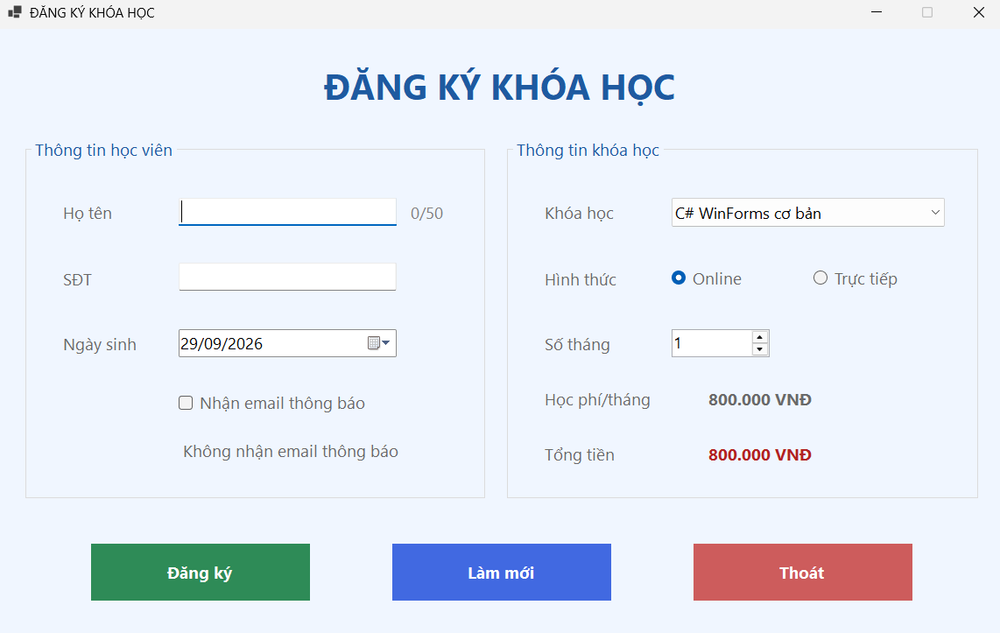
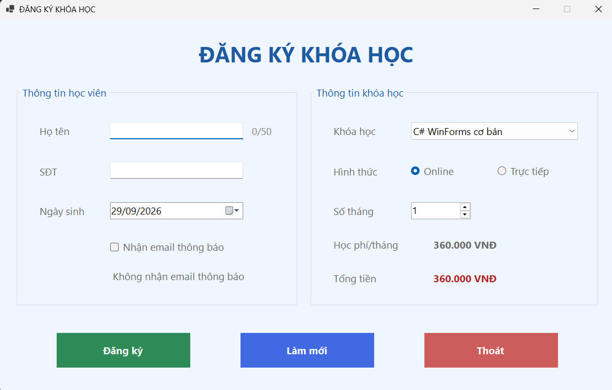
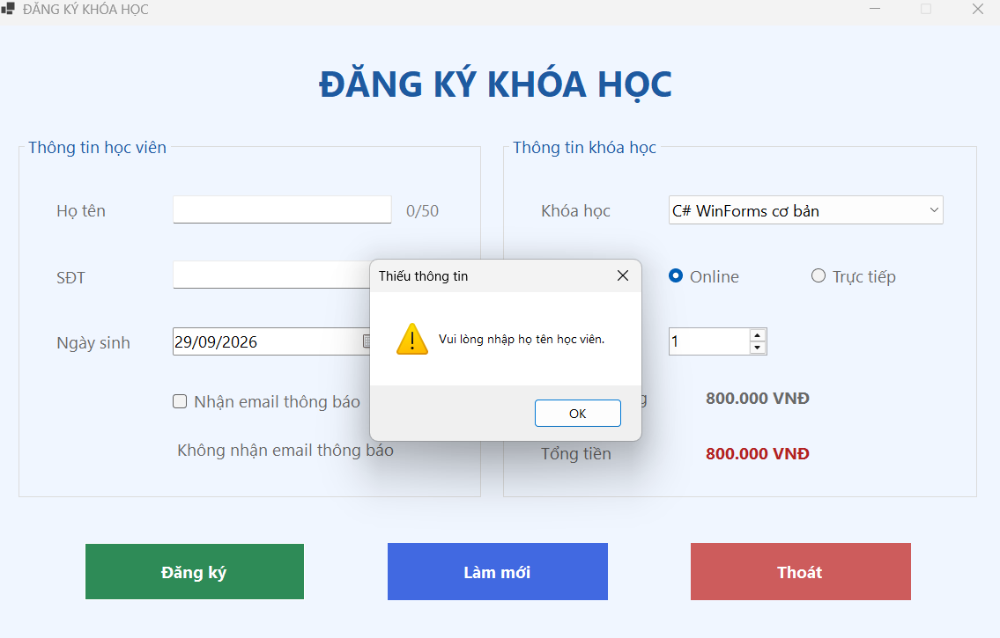
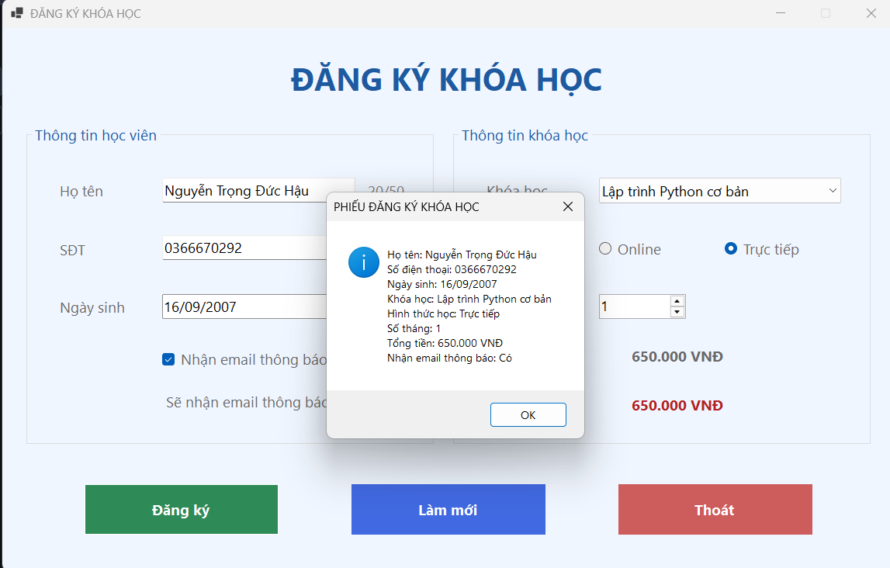
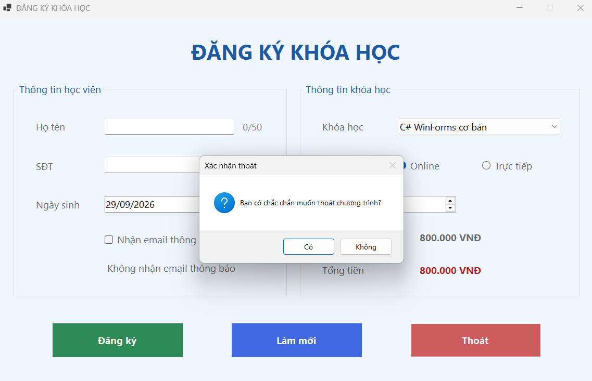

# CourseRegistrationApp – Đăng ký khóa học (WinForms)

Bài Lab buổi 5 – COMP1019 Lập trình trên Windows.

- Họ tên: ……………………  MSSV: ……………………  Lớp: ……………………

## 1. Giới thiệu
Ứng dụng Windows Forms (C#, .NET 8) dùng để đăng ký khóa học. Dữ liệu chỉ xử lý trên Form, không lưu cơ sở dữ liệu.

## 2. Công nghệ
- C#, .NET 8, Windows Forms
- Visual Studio 2022

## 3. Cách chạy
1. Clone repo, mở `CourseRegistrationApp.csproj` bằng Visual Studio 2022.
2. Nhấn **F5** để chạy.

## 4. Control sử dụng
| Nhóm | Control | Tên |
|---|---|---|
| Học viên | TextBox | txtHoTen, txtSoDienThoai |
| Học viên | DateTimePicker | dtpNgaySinh |
| Học viên | CheckBox | chkNhanEmail |
| Khóa học | ComboBox | cboKhoaHoc |
| Khóa học | RadioButton | radOnline, radOffline |
| Khóa học | NumericUpDown | numSoThang |
| Khóa học | Label | lblTongTien |
| Nút lệnh | Button | btnDangKy, btnLamMoi, btnThoat |

## 5. Chức năng & hình ảnh minh họa

### 5.1. Giao diện khi Form Load
Form nạp sẵn danh sách khóa học, chọn khóa đầu tiên, mặc định hình thức Online, số tháng = 1 và hiển thị tổng học phí ban đầu.

### 5.2. Tính học phí khi đổi khóa học / số tháng
Học phí/tháng và Tổng tiền tự cập nhật khi thay đổi khóa học hoặc số tháng (Tổng tiền = học phí/tháng x số tháng).

### 5.3. Kiểm tra dữ liệu khi bấm Đăng ký
Nếu bỏ trống họ tên (hoặc số điện thoại) chương trình báo lỗi bằng MessageBox và đưa con trỏ về ô cần nhập.

### 5.4. Phiếu đăng ký
Khi dữ liệu hợp lệ, phiếu đăng ký hiển thị: họ tên, số điện thoại, ngày sinh, khóa học, hình thức học, số tháng, tổng tiền, trạng thái nhận email.

### 5.5. Nút Làm mới
Xóa họ tên, số điện thoại; ngày sinh về ngày hiện tại; bỏ chọn nhận email; chọn lại khóa học đầu tiên, hình thức Online, số tháng = 1; đưa con trỏ về ô họ tên.

### 5.6. Xác nhận khi Thoát
Hiển thị hộp thoại xác nhận, chỉ đóng chương trình khi chọn Có (Yes).

