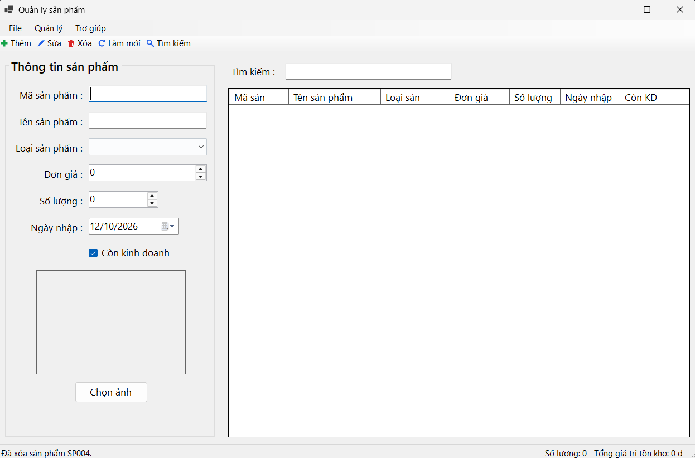
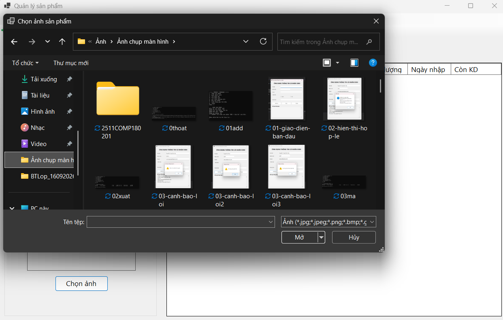
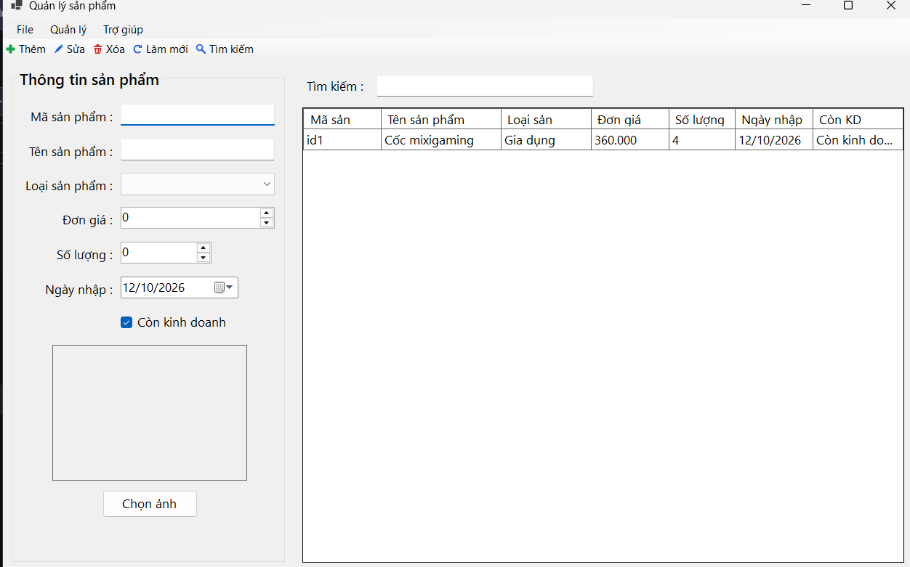
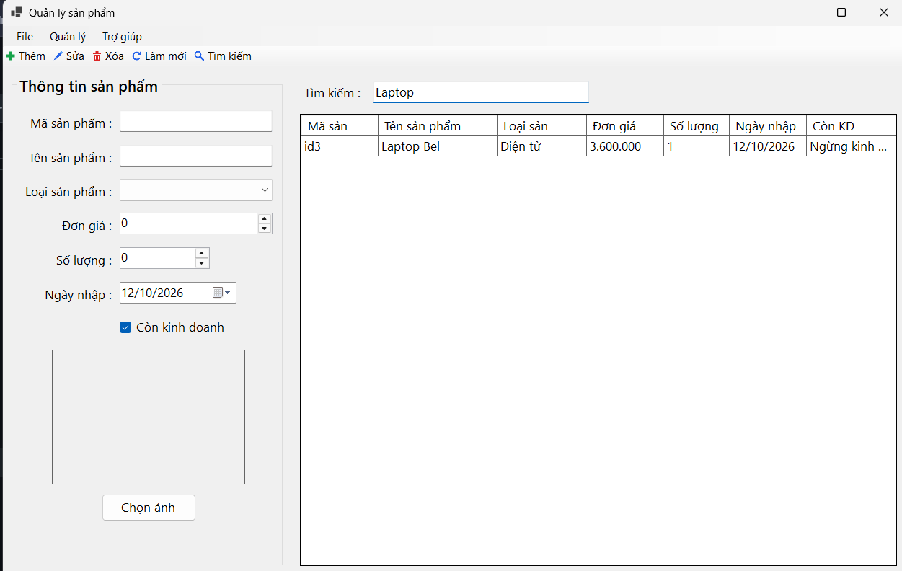
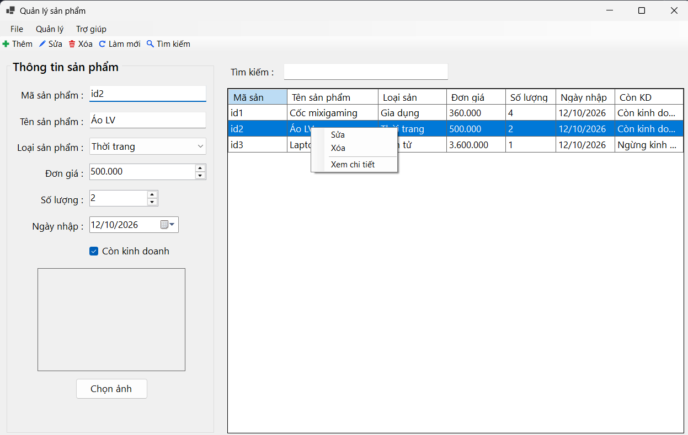
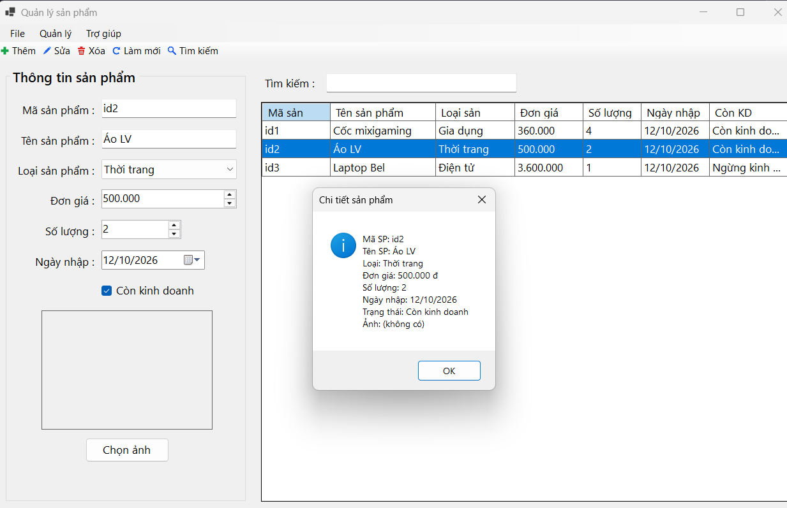
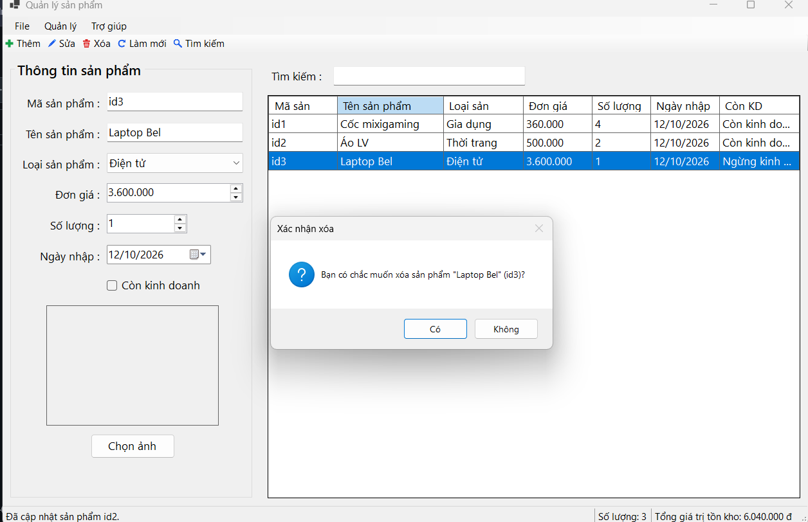

# ProductManager - Quản lý sản phẩm

**Môn học:** COMP1019 - Lập trình trên Windows
**Bài thực hành:** Lab 05 - Windows Forms nâng cao và DataGridView

| Thông tin sinh viên | |
|---|---|
| Họ và tên | ……………………………… |
| MSSV | ……………………………… |
| Lớp | ……………………………… |

## 1. Giới thiệu

Ứng dụng Windows Forms quản lý danh sách sản phẩm của một cửa hàng. Dữ liệu lưu trong bộ nhớ (`List<Product>` kết hợp `BindingSource`), chưa kết nối cơ sở dữ liệu nên khi tắt chương trình dữ liệu sẽ trở về dữ liệu mẫu.

Các control chính: `MenuStrip`, `ToolStrip`, `StatusStrip`, `ContextMenuStrip`, `DataGridView`, `BindingSource`, `ErrorProvider`, `OpenFileDialog`, `SaveFileDialog`.

## 2. Yêu cầu và cách chạy

- Hệ điều hành Windows 10/11.
- .NET 8 SDK (hoặc Visual Studio 2022 có workload *.NET desktop development*).

**Cách 1 - Visual Studio:** mở file `ProductManager.csproj`, nhấn **F5**.

**Cách 2 - Dòng lệnh:** mở terminal tại thư mục project rồi chạy:

```
dotnet run
```

## 3. Cấu trúc project

| File | Nội dung |
|---|---|
| `Program.cs` | Điểm khởi chạy ứng dụng |
| `Product.cs` | Class `Product` lưu dữ liệu sản phẩm |
| `FrmProduct.Designer.cs` | Bố cục giao diện (tên control theo đề bài) |
| `FrmProduct.cs` | Xử lý nghiệp vụ: CRUD, tìm kiếm, validation, trạng thái |
| `IconFactory.cs` | Vẽ icon cho toolbar bằng GDI+ (không cần file ảnh) |
| `docs/images/` | Ảnh chụp màn hình dùng trong README |

Các hàm chính trong `FrmProduct.cs`: `ValidateInput`, `ClearInput`, `LoadProductToForm`, `FillProductFromForm`, `UpdateStatus`, `ApplyFilter`, `OnAdd`, `OnEdit`, `OnDelete`, `OnSearch`, `OnRefresh`, `OnChooseImage`, `OnViewDetail`, `OnExport`.

## 4. Dữ liệu sản phẩm

| Trường | Kiểu | Quy định | Control |
|---|---|---|---|
| `MaSP` | string | Không rỗng, không trùng (không phân biệt hoa/thường) | `txtMaSP` |
| `TenSP` | string | Không rỗng | `txtTenSP` |
| `LoaiSP` | string | Chọn: Điện tử, Văn phòng, Gia dụng, Thời trang | `cboLoaiSP` |
| `DonGia` | decimal | Lớn hơn 0 | `numDonGia` |
| `SoLuong` | int | Lớn hơn hoặc bằng 0 | `numSoLuong` |
| `NgayNhap` | DateTime | Không lớn hơn ngày hiện tại | `dtpNgayNhap` |
| `ConKinhDoanh` | bool | Còn / ngừng kinh doanh | `chkConKinhDoanh` |
| `DuongDanAnh` | string | Có thể để trống | `picAnh` + `btnChonAnh` |

## 5. Chức năng

- **Load Form:** nạp danh sách loại sản phẩm, tạo 3 sản phẩm mẫu và hiển thị lên `dgvProducts`.
- **Thêm:** kiểm tra dữ liệu và mã không trùng, thêm vào danh sách rồi cập nhật lưới.
- **Sửa:** chọn một dòng, dữ liệu hiện lên form, chỉnh sửa rồi nhấn **Sửa**. Chưa chọn dòng thì chương trình báo nhắc, không bị lỗi.
- **Xóa:** chọn một dòng, hiện `MessageBox` xác nhận Có/Không trước khi xóa.
- **Tìm kiếm:** theo mã hoặc tên, không phân biệt hoa/thường; lọc ngay khi gõ, hoặc nhấn Enter / nút **Tìm kiếm**.
- **Làm mới:** xóa nội dung nhập, xóa lỗi `ErrorProvider`, xóa từ khóa và hiển thị lại toàn bộ dữ liệu.
- **Chọn ảnh:** dùng `OpenFileDialog` (jpg, jpeg, png, bmp, gif) và hiển thị trong `PictureBox`.
- **StatusStrip:** sau mỗi thao tác cập nhật trạng thái, số lượng sản phẩm và tổng giá trị tồn kho.
- **Xem chi tiết:** từ menu chuột phải hoặc nhấp đúp một dòng.
- **Xuất file (mở rộng):** menu *File > Xuất danh sách ra .txt* dùng `SaveFileDialog`.

### Kiểm tra dữ liệu (ErrorProvider + MessageBox)

- Mã sản phẩm và tên sản phẩm không được để trống.
- Mã sản phẩm không được trùng với sản phẩm khác.
- Phải chọn loại sản phẩm.
- Đơn giá phải lớn hơn 0, số lượng phải lớn hơn hoặc bằng 0.
- Ngày nhập không được lớn hơn ngày hiện tại.

Khi sai, từng ô nhập hiện biểu tượng lỗi bên cạnh, đồng thời có một `MessageBox` liệt kê các lỗi.

### Phím tắt

| Phím | Chức năng |
|---|---|
| Ctrl + N | Thêm |
| Ctrl + E | Sửa |
| Ctrl + D | Xóa |
| F5 | Làm mới |
| Ctrl + F | Tìm kiếm |
| Ctrl + S | Xuất danh sách ra .txt |
| Enter (trong ô tìm kiếm) | Tìm kiếm |
| Nhấp đúp một dòng | Xem chi tiết |

## 6. Hình ảnh minh họa

**Giao diện chính**



**Chọn ảnh bằng OpenFileDialog**



**Thêm sản phẩm**



**Tìm kiếm theo mã hoặc tên**



**Menu chuột phải trên DataGridView (Sửa, Xóa, Xem chi tiết)**



**Xem chi tiết sản phẩm**



**Xác nhận trước khi xóa**


