# ShopManagerMini

Ứng dụng quản lý cửa hàng mini nhiều Form, viết bằng **C# WinForms (.NET 8)**.
Bài Lab 07 – môn **COMP1019 – Lập trình trên Windows** (SDI, MDI và ứng dụng nhiều Form).

- Sinh viên: [Họ và tên]
- MSSV: [Mã số sinh viên]
- Lớp: [Tên lớp]

## Yêu cầu môi trường

- Windows 10/11
- Visual Studio 2022 (workload **.NET desktop development**) và .NET 8 SDK
- Không cần SQL Server: toàn bộ dữ liệu lưu trong bộ nhớ (`BindingList<T>`), tắt chương trình là quay về dữ liệu mẫu.

## Cách chạy

1. Mở file `ShopManagerMini.csproj` bằng Visual Studio.
2. Nhấn **F5** (hoặc *Debug > Start Debugging*).
3. Đăng nhập bằng một trong các tài khoản mẫu bên dưới.

Nếu dùng phiên bản .NET khác, sửa `TargetFramework` trong `ShopManagerMini.csproj`.

## Tài khoản mẫu

| Username | Password | Họ tên             | Vai trò |
|----------|----------|--------------------|---------|
| admin    | 123      | Quản trị viên      | Admin   |
| user     | 123      | Nhân viên bán hàng | User    |

## Chức năng

**Đăng nhập (`FrmLogin`)**
- Mở bằng `ShowDialog()`, trả `DialogResult.OK` khi đúng tài khoản.
- Cảnh báo khi bỏ trống, báo lỗi khi sai username/password.

**Form chính (`FrmMain`, MDI Parent)**
- Menu *Hệ thống* (Đăng xuất, Thoát), *Danh mục* (Quản lý sản phẩm, Quản lý khách hàng), *Trợ giúp* (Giới thiệu).
- StatusStrip hiển thị tên người dùng, vai trò và thời gian hiện tại.
- Form con mở bên trong Form chính; bấm menu nhiều lần chỉ kích hoạt lại Form đã mở, không tạo trùng.
- Hỏi xác nhận khi thoát hoặc đăng xuất.

**Quản lý sản phẩm (`FrmProduct`)**
- Thông tin: mã, tên, loại, đơn giá, số lượng.
- Thêm, Sửa, Xóa, Làm mới, Tìm kiếm (theo mã, tên, loại) trên DataGridView.
- Kiểm tra: không để trống, không trùng mã, đơn giá và số lượng không âm.
- Hỏi xác nhận trước khi xóa.

**Quản lý khách hàng (`FrmCustomer`)**
- Thông tin: mã, họ tên, số điện thoại, loại khách hàng.
- Thêm, Sửa, Xóa, Làm mới, Tìm kiếm (theo mã, tên, số điện thoại).
- Kiểm tra: không để trống, không trùng mã, số điện thoại gồm 9-11 chữ số.

**Giới thiệu (`FrmAbout`)**: thông tin ứng dụng, sinh viên, lớp.

## Cách sử dụng nhanh (Sản phẩm / Khách hàng)

- **Thêm**: nhập thông tin vào các ô rồi bấm *Thêm*.
- **Sửa**: chọn một dòng trong danh sách (mã bị khóa), đổi thông tin rồi bấm *Sửa*.
- **Xóa**: chọn một dòng rồi bấm *Xóa* và xác nhận.
- **Làm mới**: xóa ô nhập, bỏ chọn và hiển thị lại toàn bộ danh sách.
- **Tìm kiếm**: nhập từ khóa rồi bấm *Tìm kiếm*; bấm *Làm mới* để quay lại danh sách đầy đủ.

## Cấu trúc project

```
ShopManagerMini
|-- Models
|   |-- User.cs
|   |-- Product.cs
|   |-- Customer.cs
|   |-- DataStore.cs      # dữ liệu mẫu và kho dữ liệu trong bộ nhớ
|
|-- Forms
|   |-- FrmLogin.cs
|   |-- FrmMain.cs
|   |-- FrmProduct.cs
|   |-- FrmCustomer.cs
|   |-- FrmAbout.cs
|   |-- UiHelper.cs       # hàm hỗ trợ tạo control
|
|-- Program.cs            # vòng lặp Đăng nhập -> Form chính -> Đăng xuất
|-- images                # ảnh chụp các màn hình chính
|-- TraLoiCauHoi.md       # trả lời 5 câu hỏi nộp kèm
```

## Luồng truyền dữ liệu

`FrmLogin` lưu người dùng vào property `LoggedInUser` → `Program.cs` đọc sau `ShowDialog()` → truyền vào constructor `FrmMain(User user)` → hiển thị lên StatusStrip.

## Ảnh minh họa

**1. Màn hình đăng nhập**

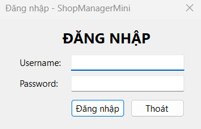

**2. Form chính MDI với StatusStrip (tên người dùng, vai trò, thời gian)**

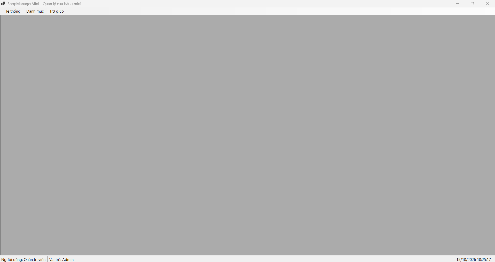

**3. Thêm sản phẩm thành công, hai Form con mở trong Form chính**

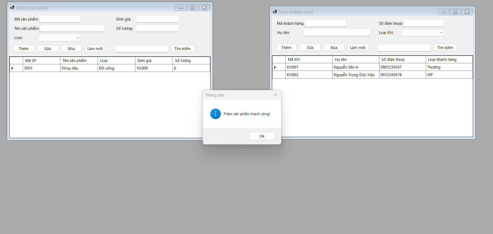

**4. Cảnh báo đơn giá không hợp lệ**

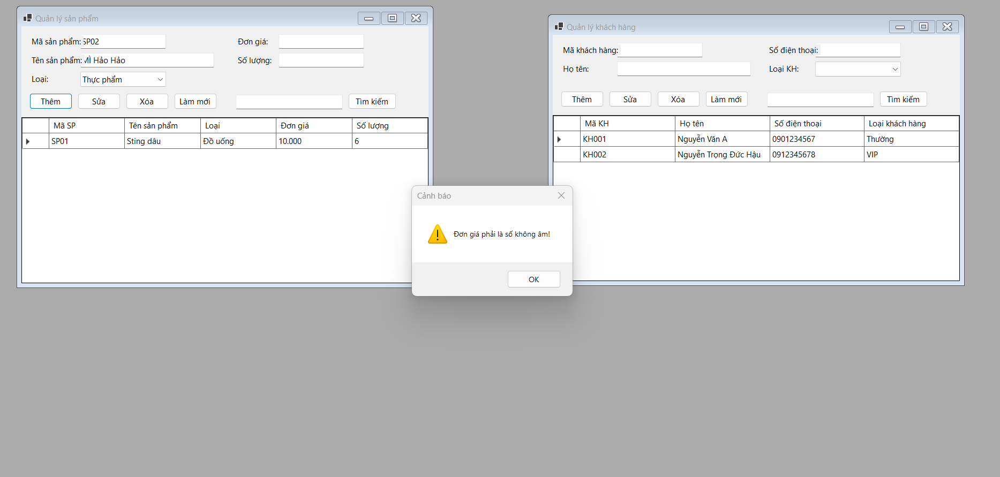

**5. Cảnh báo số lượng âm**

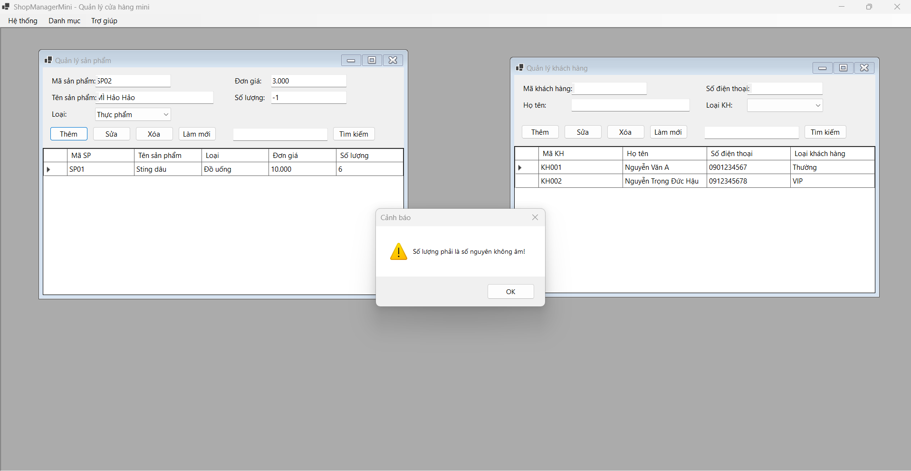

**6. Cập nhật sản phẩm thành công**

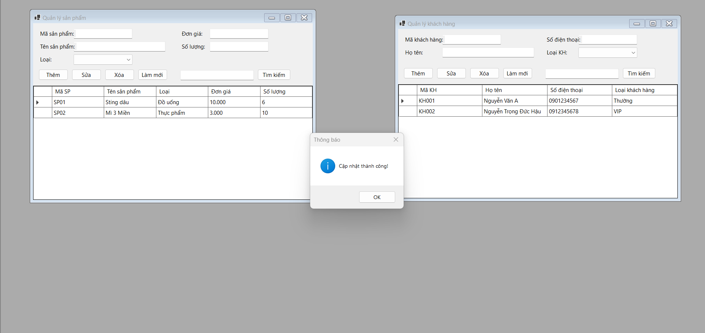

**7. Xác nhận trước khi xóa sản phẩm**

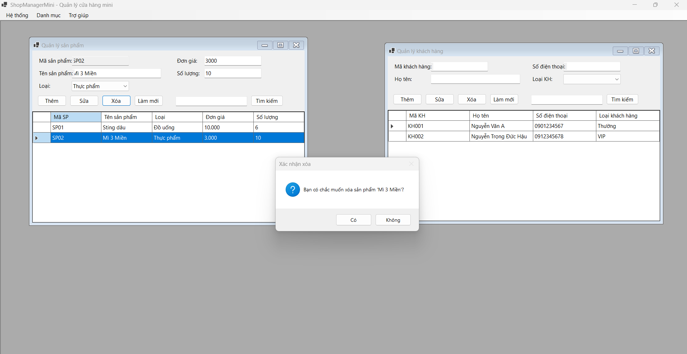

**8. Tìm kiếm sản phẩm**

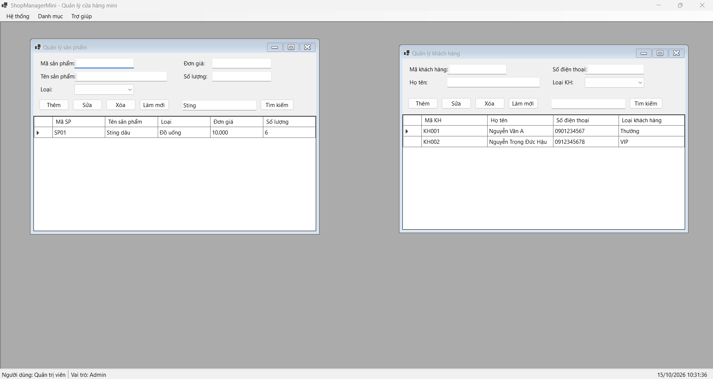

**9. Thêm khách hàng thành công**

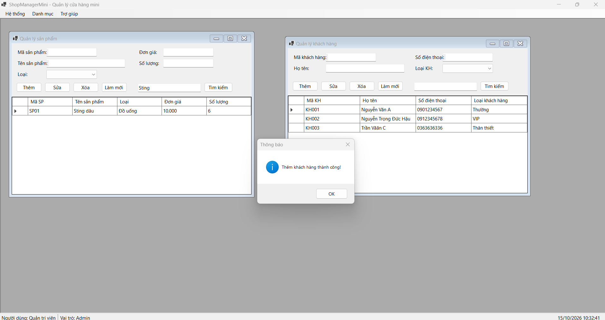

**10. Cập nhật khách hàng thành công**

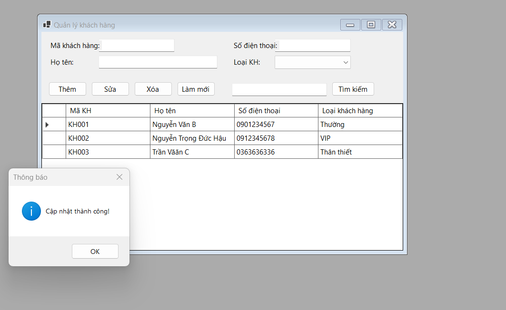

**11. Tìm kiếm khách hàng**

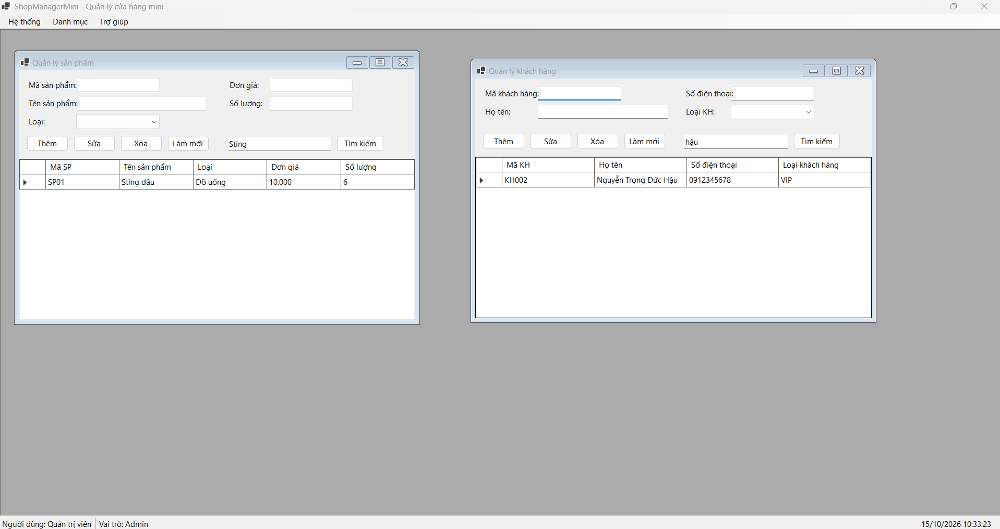

**12. Cảnh báo số điện thoại không hợp lệ**

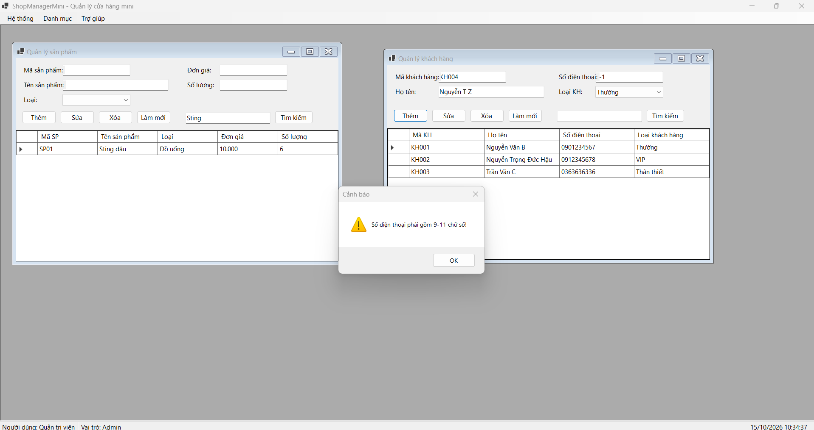

## Ghi chú

- Giao diện được dựng bằng code (không dùng Designer).
- Dữ liệu chỉ lưu trong bộ nhớ, chưa kết nối cơ sở dữ liệu.
