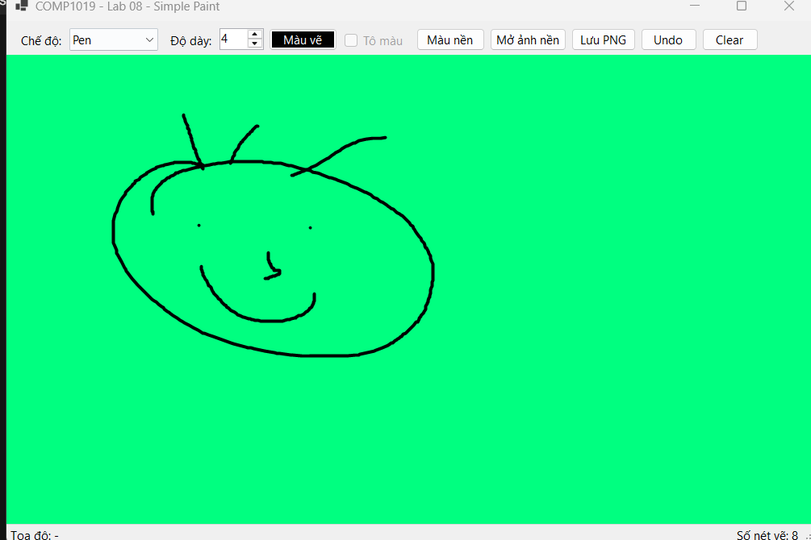
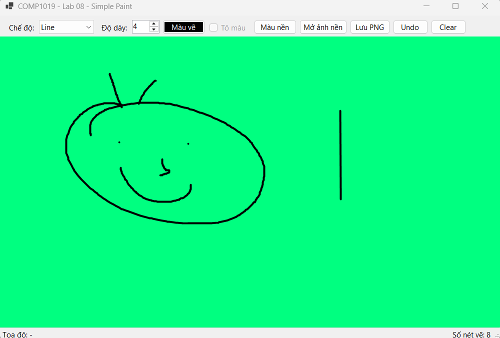
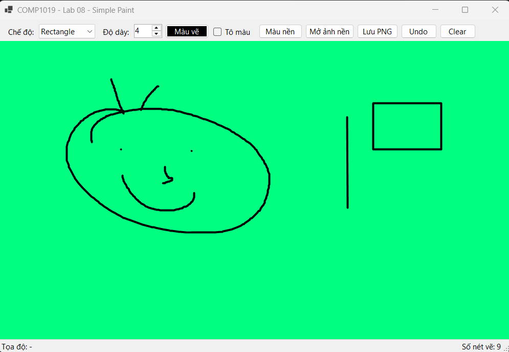
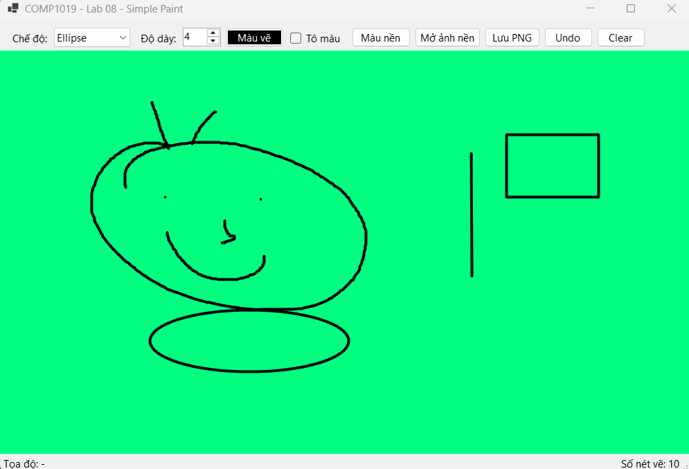
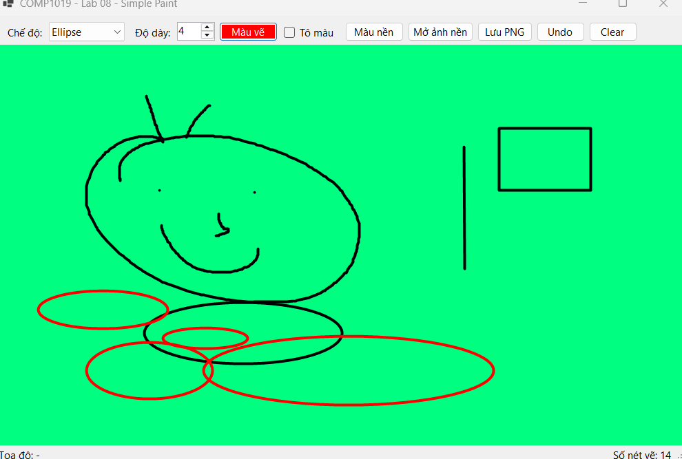
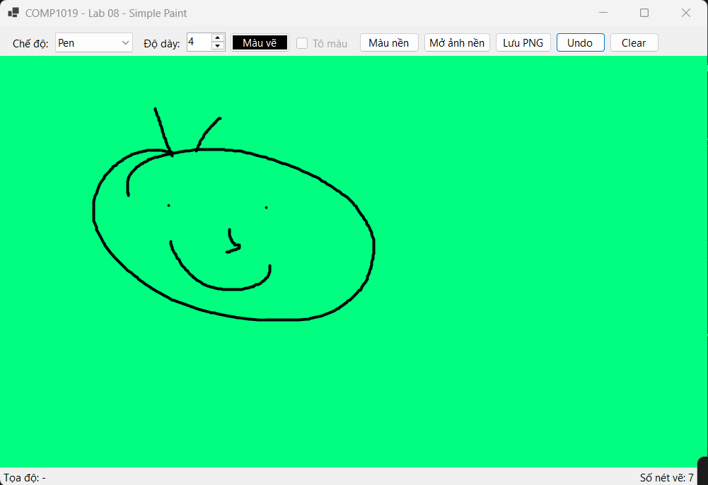
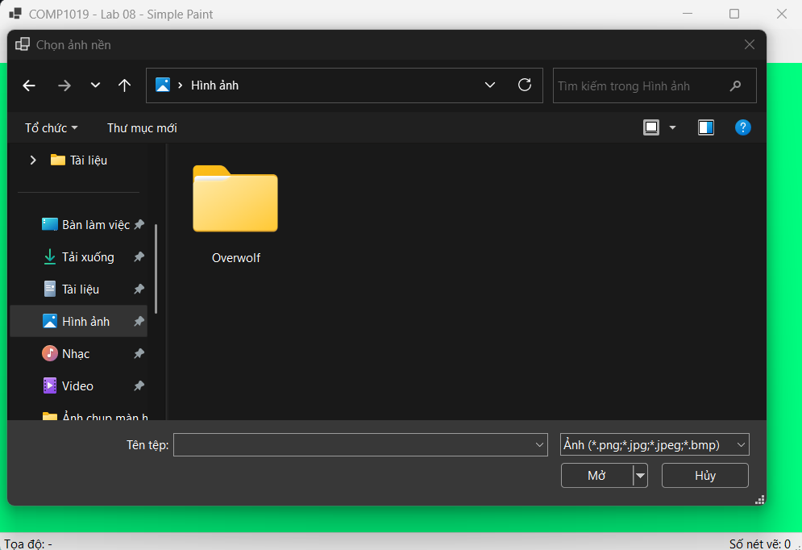
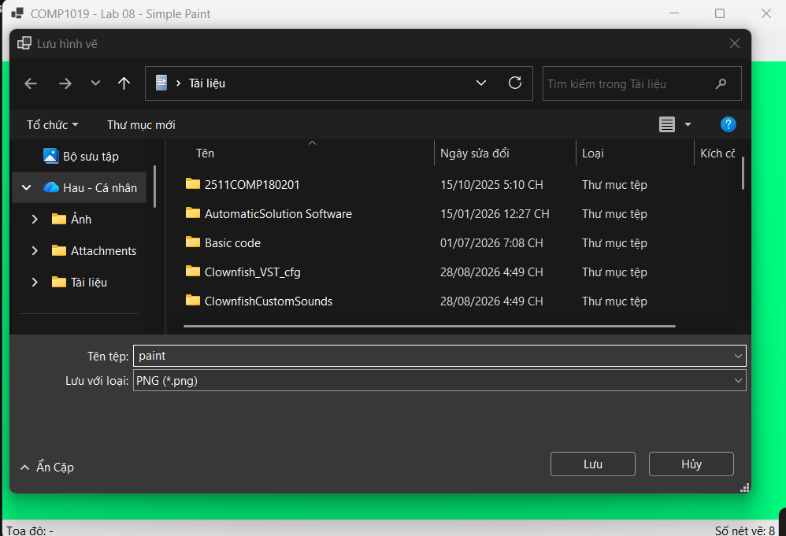

# COMP1019 – Lab 08: Simple Paint

Ứng dụng Paint đơn giản viết bằng **C# WinForms (.NET 8)** và **GDI+**.
Môn **COMP1019 – Lập trình trên Windows**, Buổi 8.

- Sinh viên: [Họ và tên]
- MSSV: [Mã số sinh viên]
- Lớp: [Tên lớp]

## Cách chạy

1. Cài Visual Studio 2022 trở lên (workload **.NET desktop development**) và .NET 8 SDK.
2. Mở file `COMP1019_Lab08_SimplePaint.csproj` bằng Visual Studio.
3. Nhấn **F5** để chạy.

Dùng .NET khác thì sửa `TargetFramework` trong file `.csproj`.
Chạy bằng dòng lệnh: `dotnet run` trong thư mục project.

## Cách sử dụng

1. Chọn **chế độ** (Pen, Line, Rectangle, Ellipse), **độ dày** (1-20) và **màu vẽ**.
2. Nhấn giữ chuột trái trên canvas và kéo để vẽ, thả chuột để hoàn tất.
3. **Undo** (hoặc `Ctrl+Z`) xóa nét vẽ gần nhất, **Clear** xóa toàn bộ nét vẽ.
4. Thanh trạng thái phía dưới hiển thị tọa độ chuột và số nét đã vẽ.

## Chức năng

**Bắt buộc**
- Vẽ tự do (Pen), đường thẳng (Line), hình chữ nhật (Rectangle), ellipse (Ellipse).
- Chọn màu bằng `ColorDialog`, chọn độ dày bằng `NumericUpDown`.
- Undo, Clear, hiển thị tọa độ chuột trên Status Label.
- Nét vẽ không mất khi resize hoặc bị che rồi hiện lại.
- Kéo chuột theo mọi hướng đều vẽ đúng hình chữ nhật và ellipse.

**Nâng cao**
- Lưu vùng vẽ ra file PNG (nút *Lưu PNG* hoặc `Ctrl+S`).
- Mở ảnh nền để vẽ đè lên (nút *Mở ảnh nền*).
- Phím tắt `Ctrl+Z` để Undo.
- Chế độ **Tô màu** cho Rectangle và Ellipse.
- Đổi màu nền canvas (nút *Màu nền*).

## Kỹ thuật chính

- Mọi nét vẽ được lưu trong `List<DrawItem>` (loại hình, màu, độ dày, tọa độ).
- Canvas vẽ lại toàn bộ từ danh sách này trong sự kiện `Paint`; dữ liệu thay đổi thì gọi `canvas.Invalidate()`.
- Nét đang kéo chuột được lưu trong `_current` để xem trước hình trước khi thả chuột.
- `DrawItem.GetBounds()` chuẩn hóa hai điểm để kéo theo mọi hướng đều đúng.
- `Pen`, `SolidBrush`, `Bitmap`, `ColorDialog`... tự tạo đều được giải phóng bằng `using` hoặc `Dispose`.
- Dùng `DoubleBufferedPanel` để vẽ không nhấp nháy.
- Có `try/catch` khi mở và lưu ảnh.

## Cấu trúc project

```
COMP1019_Lab08_SimplePaint
|-- Program.cs
|-- FrmPaint.cs             # giao diện và xử lý chuột, nút
|-- DrawItem.cs             # đối tượng nét vẽ và hàm Draw
|-- ShapeMode.cs            # enum chế độ vẽ
|-- DoubleBufferedPanel.cs  # canvas chống nhấp nháy
|-- images/                 # ảnh chụp màn hình
```

## Ảnh chụp màn hình

**1. Chế độ Pen: vẽ tự do**



**2. Chế độ Line: vẽ đường thẳng**



**3. Chế độ Rectangle: vẽ hình chữ nhật**



**4. Chế độ Ellipse: vẽ hình ellipse**



**5. Đổi màu vẽ (đỏ) và vẽ nhiều ellipse, kéo chuột theo nhiều hướng**



**6. Undo: xóa nét vẽ gần nhất (số nét giảm từ 8 xuống 7)**



**7. Hộp thoại mở ảnh nền**



**8. Hộp thoại lưu hình vẽ ra file PNG**


