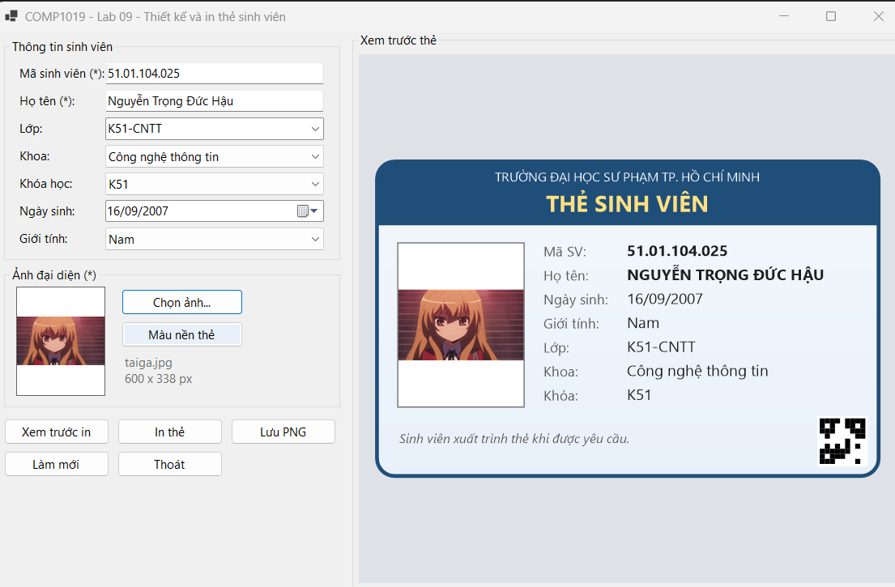
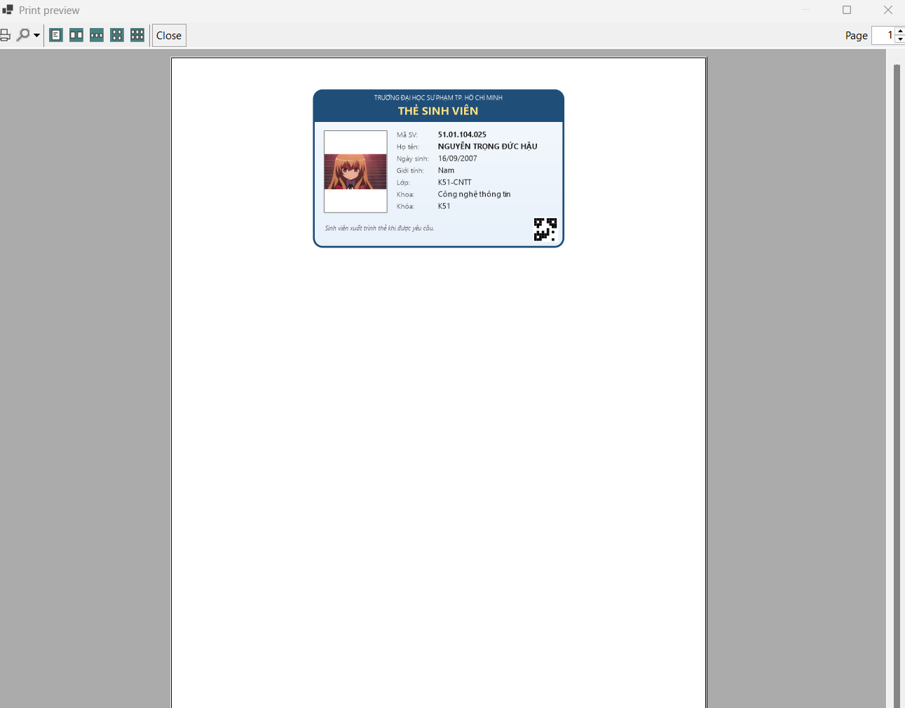
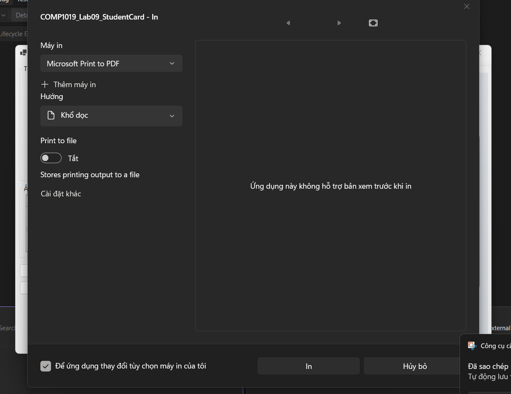
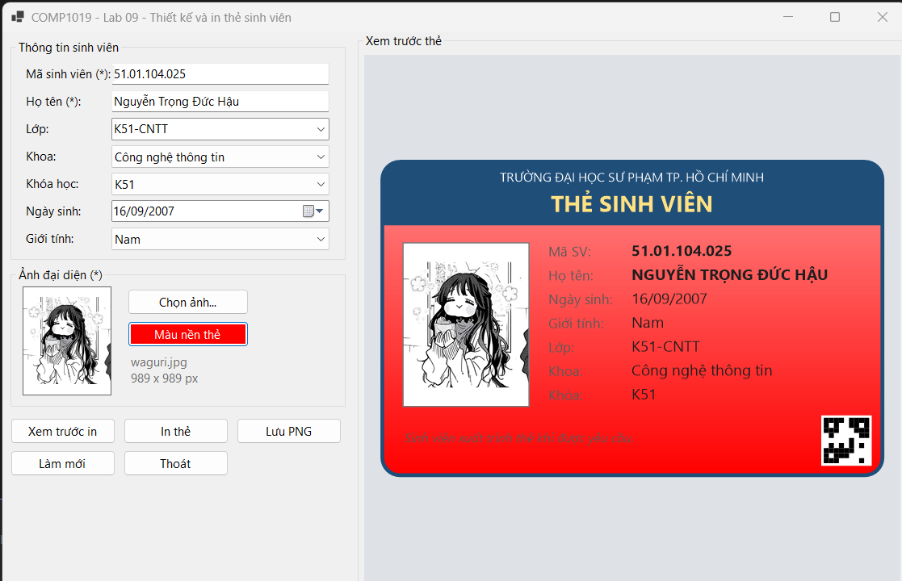
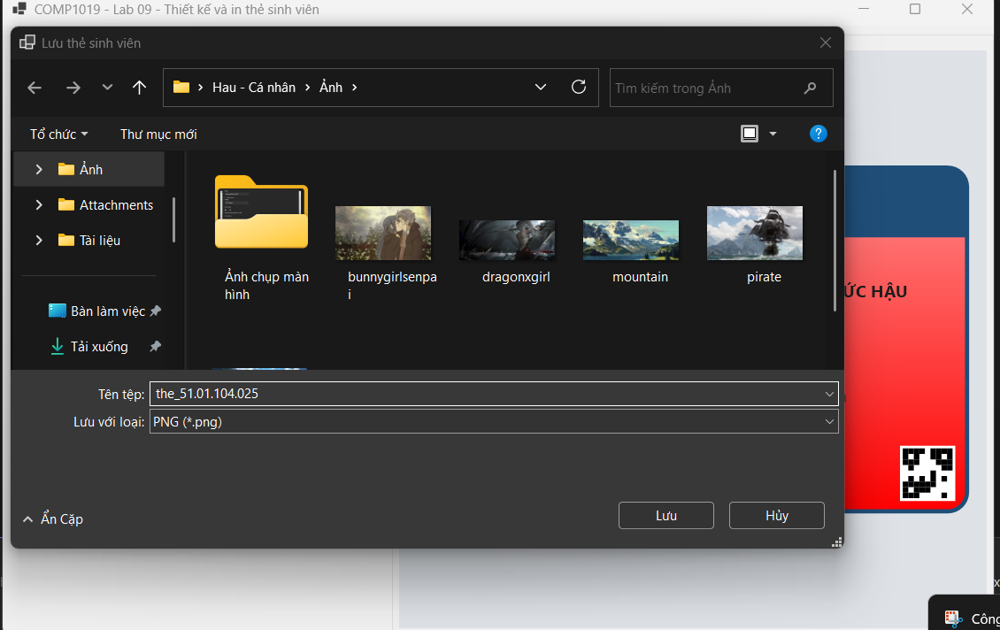

# COMP1019 – Lab 09: Thiết kế và in thẻ sinh viên

Ứng dụng WinForms (**C#, .NET 8**) nhập thông tin sinh viên, chọn ảnh đại diện, xem trước thẻ bằng **GDI+** và in thẻ bằng **PrintDocument**.
Môn **COMP1019 – Lập trình trên Windows**, Buổi 9.

- Sinh viên: Nguyễn Trọng Đức Hậu
- MSSV: 51.01.104.025
- Lớp: 51.CNTT.A

## Cách chạy

1. Cài Visual Studio 2022 trở lên (workload **.NET desktop development**) và .NET 8 SDK.
2. Mở file `COMP1019_Lab09_StudentCard.csproj` bằng Visual Studio.
3. Nhấn **F5** để chạy.

Dùng .NET khác thì sửa `TargetFramework` trong file `.csproj`. Chạy bằng dòng lệnh: `dotnet run`.
Máy cần có ít nhất một máy in (ví dụ *Microsoft Print to PDF*) để dùng chức năng xem trước in và in.

## Cách sử dụng

1. Nhập **Mã sinh viên** và **Họ tên** (bắt buộc), chọn lớp, khoa, khóa học, ngày sinh, giới tính.
2. Bấm **Chọn ảnh...** để chọn ảnh đại diện (JPG, JPEG, PNG, BMP). Thẻ bên phải cập nhật ngay khi dữ liệu thay đổi.
3. Bấm **Xem trước in** để xem bản in, hoặc **In thẻ** để chọn máy in và in.
4. **Làm mới** đưa Form về trạng thái ban đầu, **Thoát** để đóng chương trình.

## Chức năng

| Mã | Chức năng | Mô tả |
|----|-----------|-------|
| F1 | Chọn ảnh | `OpenFileDialog` có Filter ảnh; ảnh hiển thị trong `PictureBox` chế độ Zoom |
| F2 | Preview thẻ | Panel vẽ thẻ bằng GDI+ trong sự kiện `Paint`, tự vẽ lại khi dữ liệu đổi |
| F3 | Validation | Không cho xem trước in, in, lưu PNG nếu thiếu mã SV, họ tên hoặc ảnh; ngày sinh không ở tương lai |
| F4 | Print Preview | `PrintPreviewDialog` |
| F5 | Print | `PrintDialog` và `PrintDocument` |
| F6 | Làm mới | Xóa dữ liệu, xóa ảnh, về trạng thái ban đầu |

**Mở rộng đã làm:** chọn màu nền thẻ, lưu thẻ ra file PNG, mã QR giả lập vẽ bằng ô vuông.

## Kỹ thuật chính

- `CardRenderer` là một hàm vẽ thẻ dùng chung cho **Panel preview**, **bản in** và **lưu PNG**, nên ba nơi luôn giống nhau.
- Thẻ được thiết kế trong không gian 400 x 252 rồi phóng to/thu nhỏ bằng `ScaleTransform`, nên vẽ đúng ở mọi kích thước.
- Ảnh luôn được vẽ giữ đúng tỉ lệ (căn giữa trong khung 3x4), không bị méo.
- Ảnh được đọc qua `FileStream` và sao chép sang `Bitmap` mới, nên **không khóa file gốc**; ảnh cũ được `Dispose` khi đổi ảnh.
- `Pen`, `Brush`, `Font`, `Bitmap`, các hộp thoại... tự tạo đều được giải phóng bằng `using`/`Dispose`.
- Có `try/catch` khi đọc ảnh, lưu ảnh và in; `ErrorProvider` đánh dấu ô bị thiếu.

## Cấu trúc project

```
COMP1019_Lab09_StudentCard
|-- Program.cs
|-- FrmStudentCard.cs       # Form chính: nhập liệu, ảnh, validation, in ấn
|-- CardRenderer.cs         # vẽ thẻ bằng GDI+ (preview, in, PNG)
|-- StudentInfo.cs          # dữ liệu sinh viên
|-- DoubleBufferedPanel.cs  # panel chống nhấp nháy
|-- images/                 # ảnh chụp màn hình
|-- TestCases.md            # các test case đã kiểm thử
```

## Ảnh chụp màn hình

**1. Form chính: nhập thông tin, chọn ảnh và xem trước thẻ**



**2. Print Preview: bản xem trước khi in**



**3. Hộp thoại in (PrintDialog) với máy in Microsoft Print to PDF**



**4. Đổi màu nền thẻ (mở rộng) và đổi ảnh đại diện**



**5. Lưu thẻ ra file PNG (mở rộng)**


