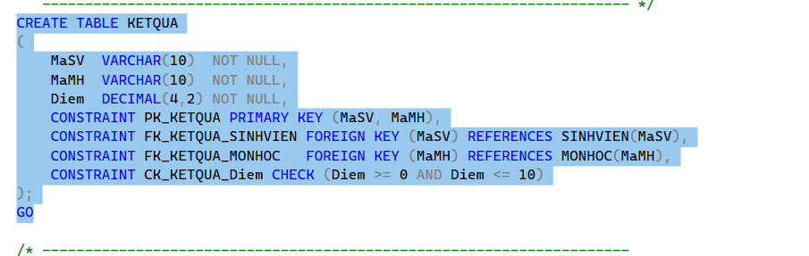
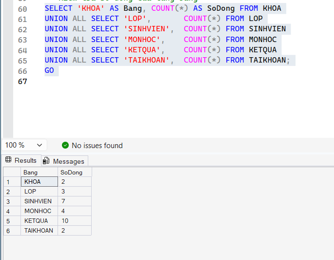
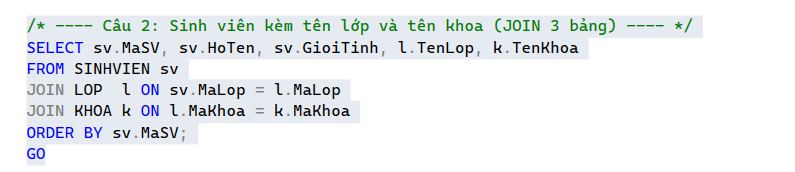
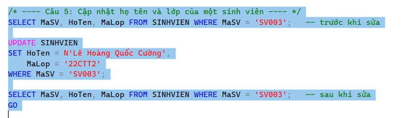
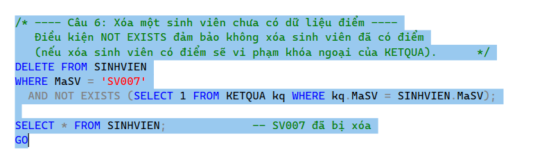
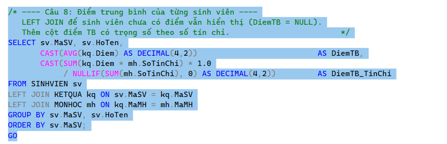
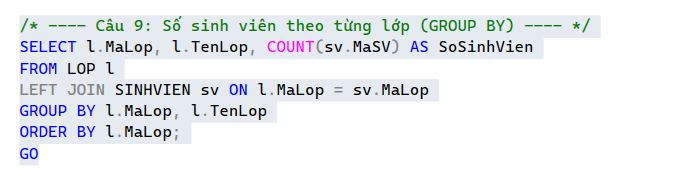
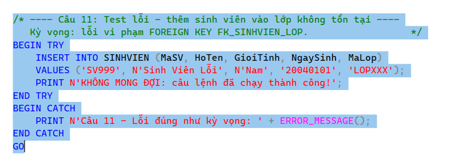
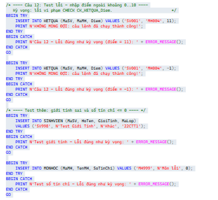

# Lab 10 - EduManagerDB (SQL Server)

**Môn:** COMP1019 - Lập trình trên Windows  
**Họ tên / MSSV:** ........................................

## 1. Cách chạy (bằng SSMS)
1. Kết nối vào SQL Server (ví dụ `localhost\SQLEXPRESS`, Windows Authentication, tick *Trust Server Certificate*).
2. Mở và chạy `01_CreateDatabase.sql` (tự xóa DB cũ nếu có, tạo DB + 6 bảng).
3. Chạy `02_InsertSampleData.sql` (2 khoa, 3 lớp, 7 sinh viên, 4 môn, 10 kết quả, 2 tài khoản).
4. Chạy `03_Queries.sql` từng câu một; câu 11-12 xem thông báo ở tab Messages.

## 2. Thiết kế
KHOA 1-n LOP 1-n SINHVIEN 1-n KETQUA n-1 MONHOC; TAIKHOAN độc lập.

| Ràng buộc | Nơi áp dụng |
|---|---|
| PK | mọi bảng (KETQUA: khóa kép MaSV + MaMH) |
| FK | LOP->KHOA, SINHVIEN->LOP, KETQUA->SINHVIEN/MONHOC |
| CHECK Diem 0..10 | KETQUA |
| CHECK GioiTinh IN (Nam, Nữ) | SINHVIEN |
| CHECK SoTinChi > 0 | MONHOC |

Tài khoản demo: `admin / Admin@123`, `user1 / User@123` (mật khẩu lưu dạng băm SHA-256).

## 3. Ảnh chụp kết quả

### 3.1 Tạo bảng KETQUA (khóa chính kép, 2 khóa ngoại, CHECK điểm)

### 3.2 Số dòng dữ liệu mẫu của từng bảng
2 khoa, 3 lớp, 7 sinh viên, 4 môn học, 10 kết quả, 2 tài khoản - đạt yêu cầu tối thiểu.

### 3.3 Câu 2 - Sinh viên kèm tên lớp và tên khoa (JOIN 3 bảng)

### 3.4 Câu 5 - Cập nhật họ tên và lớp của sinh viên SV003

### 3.5 Câu 6 - Xóa sinh viên chưa có điểm (SV007)
Điều kiện `NOT EXISTS` đảm bảo không xóa sinh viên đã có dữ liệu điểm.

### 3.6 Câu 8 - Điểm trung bình của từng sinh viên

### 3.7 Câu 9 - Thống kê số sinh viên theo lớp

### 3.8 Câu 11 - Test lỗi: thêm sinh viên vào lớp không tồn tại
Kết quả mong đợi: lỗi vi phạm khóa ngoại `FK_SINHVIEN_LOP`.

### 3.9 Câu 12 - Test lỗi: điểm ngoài khoảng 0..10
Kết quả mong đợi: lỗi vi phạm `CK_KETQUA_Diem`. Có thêm test giới tính sai và số tín chỉ bằng 0.

## 4. Nhận xét
- Các ràng buộc PK, FK, CHECK hoạt động đúng; dữ liệu sai bị từ chối.
- Câu 8 dùng LEFT JOIN nên sinh viên chưa có điểm vẫn được liệt kê (điểm TB = NULL).
- Các test lỗi dùng TRY...CATCH nên script chạy liền mạch và in thông báo lỗi.
