# COMP1019 – Lab 11: ADO.NET và CRUD với SQL Server

Ứng dụng WinForms (**C#, .NET 8**) quản lý lớp học, kết nối SQL Server bằng **ADO.NET** (`Microsoft.Data.SqlClient`).
Môn **COMP1019 – Lập trình trên Windows**, Buổi 11.

- Sinh viên: Nguyễn Trọng Đức Hậu
- MSSV: 51.01.104.025
- Lớp: 51.CNTT.A

## Cách chạy

1. Cài SQL Server (bản Developer/Express đều được) và SSMS; đảm bảo dịch vụ SQL Server đang chạy.
2. Mở `Database/EduManagerDB.sql` trong SSMS rồi bấm **Execute (F5)** để tạo database `EduManagerDB`, hai bảng `LOP`, `SINHVIEN` và dữ liệu mẫu. Script chạy lại nhiều lần vẫn an toàn.
3. Mở `COMP1019_Lab11_AdoNet.csproj` bằng Visual Studio 2022 (workload **.NET desktop development**, .NET 8 SDK). Visual Studio tự tải package `Microsoft.Data.SqlClient` khi build.
4. Nhấn **F5** để chạy.

Chạy bằng dòng lệnh: `dotnet run` trong thư mục project.

## Connection string

Ứng dụng dùng **Windows Authentication**. Class `Data/DbConfig.cs` tự dò lần lượt các server sau và dùng server đầu tiên kết nối được:

| Thứ tự | Server | Dùng cho |
|--------|--------|----------|
| 1 | `localhost` | SQL Server bản mặc định (Developer, Standard...) |
| 2 | `.\SQLEXPRESS` | SQL Server Express |
| 3 | `(localdb)\MSSQLLocalDB` | LocalDB đi kèm Visual Studio |

Connection string tạo ra có dạng:

```
Data Source=<server>;Initial Catalog=EduManagerDB;Integrated Security=True;TrustServerCertificate=True
```

Server đang dùng được hiển thị ở thanh trạng thái phía dưới Form.

**Connection string trên máy cá nhân:** `Data Source=.\SQLEXPRESS;Initial Catalog=EduManagerDB;Integrated Security=True;TrustServerCertificate=True` (SQL Server Express, Windows Authentication)

Muốn cố định connection string:
- Điền vào hằng `FixedConnectionString` trong `Data/DbConfig.cs`, hoặc
- Đặt biến môi trường `EDUMANAGER_CONNECTION`.

Ví dụ dùng SQL Authentication: `Data Source=localhost;Initial Catalog=EduManagerDB;User ID=sa;Password=<mật khẩu>;TrustServerCertificate=True`

## Chức năng

| Mã | Chức năng | Mô tả |
|----|-----------|-------|
| F1 | Load dữ liệu | Mở Form tự nạp danh sách lớp từ SQL Server lên `dgvLop` (kèm số sinh viên mỗi lớp) |
| F2 | Chọn dòng | Chọn dòng thì đưa mã lớp, tên lớp lên `txtMaLop`, `txtTenLop` |
| F3 | Thêm | Không cho thêm nếu mã rỗng, tên rỗng hoặc mã đã tồn tại |
| F4 | Sửa | Cập nhật tên lớp theo mã đang chọn; chưa chọn thì cảnh báo |
| F5 | Xóa | Không cho xóa lớp đang có sinh viên; hỏi xác nhận trước khi xóa; xử lý cả lỗi khóa ngoại (SQL error 547) |
| F6 | Tìm kiếm | Tìm theo mã hoặc tên bằng `LIKE` với parameter (có escape ký tự `%`, `_`, `[`) |
| F7 | Làm mới | Xóa nội dung ô nhập, mở khóa `txtMaLop`, xóa ô tìm kiếm, nạp lại dữ liệu |
| F8 | Parameter | Mọi câu SQL nhận dữ liệu người dùng đều dùng `SqlParameter`, không nối chuỗi |

## Kỹ thuật chính

- Tách lớp rõ ràng: `FrmLop` (giao diện), `LopRepository` (truy cập dữ liệu), `LopValidator` (kiểm tra dữ liệu, không phụ thuộc giao diện hay database nên dễ kiểm thử), `DbConfig` (kết nối), `Lop` (model).
- `SqlConnection`, `SqlCommand`, `SqlDataAdapter` đều dùng `using` để tự giải phóng.
- Tham số khai báo kiểu và độ dài (`VarChar(20)` cho mã, `NVarChar(100)` cho tên) để lưu đúng tiếng Việt có dấu.
- `try/catch` bắt `SqlException`; xử lý riêng lỗi trùng khóa chính (2627, 2601), lỗi khóa ngoại (547), lỗi không có database (4060).
- Tự phát hiện bảng `LOP` có cột bắt buộc ngoài mã và tên lớp (database buổi 10) và hỏi người dùng cho phép NULL.
- Phòng trường hợp dữ liệu đổi giữa lúc kiểm tra và lúc ghi (hai người dùng cùng thao tác) bằng cách bắt cả lỗi từ SQL Server, không chỉ kiểm tra trước.

## Cấu trúc project

```
COMP1019_Lab11_AdoNet
|-- Program.cs
|-- FrmLop.cs                # giao diện và xử lý sự kiện
|-- Data
|   |-- DbConfig.cs          # connection string
|   |-- LopRepository.cs     # truy vấn SQL với parameter
|   |-- LopValidator.cs      # kiểm tra dữ liệu nhập
|-- Models
|   |-- Lop.cs
|   |-- SchemaFix.cs         # cột thừa cần cho phép NULL
|-- Database
|   |-- EduManagerDB.sql     # script tạo database và dữ liệu mẫu
|-- images                   # ảnh chụp màn hình
|-- TestCases.md             # các test case kiểm thử
```

## Ảnh chụp màn hình

### Form quản lý lớp học (kết nối SQL Server)

**1. F1 – Form tự nạp danh sách lớp từ SQL Server khi mở (thanh trạng thái hiện server `.\SQLEXPRESS` và database `EduManagerDB`)**

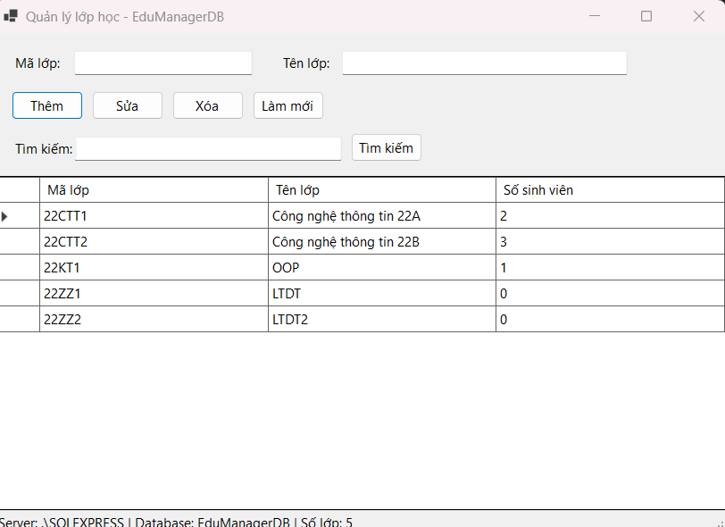

**2. F2 – Chọn một dòng: mã lớp và tên lớp được đưa lên ô nhập, ô mã lớp bị khóa**

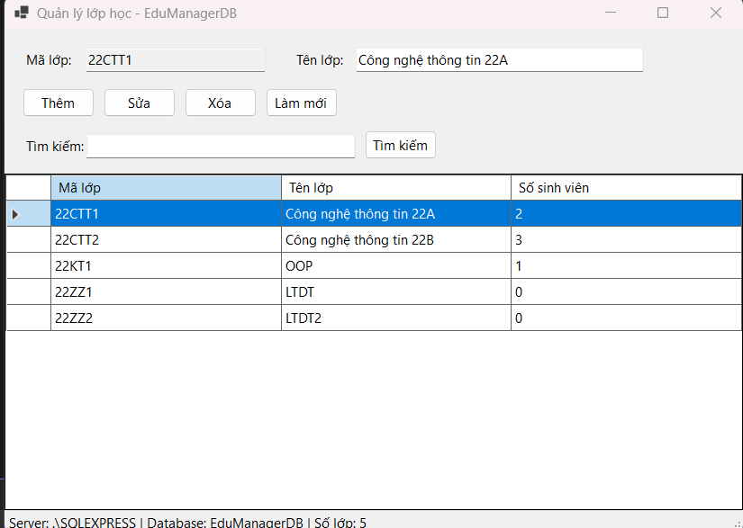

**3. F3 – Thêm lớp mới thành công**

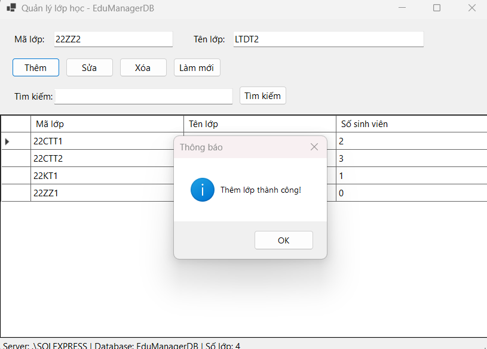

**4. F4 – Sửa tên lớp 22CTT2 thành "Lập trình cơ bản 2"**

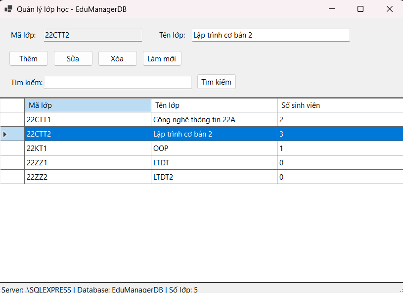

**5. F5 – Hộp thoại xác nhận trước khi xóa lớp**

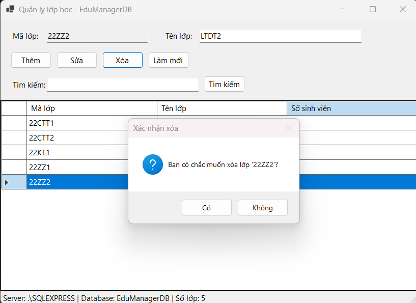

**6. F5 – Không cho xóa lớp đang có sinh viên (22CTT1 có 2 sinh viên)**

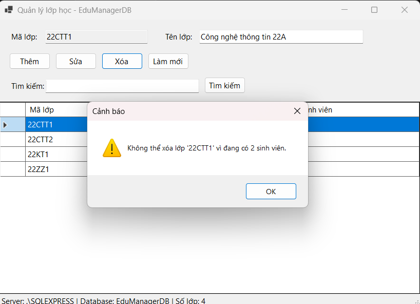

**7. F6 – Tìm kiếm theo từ khóa "OOP"**

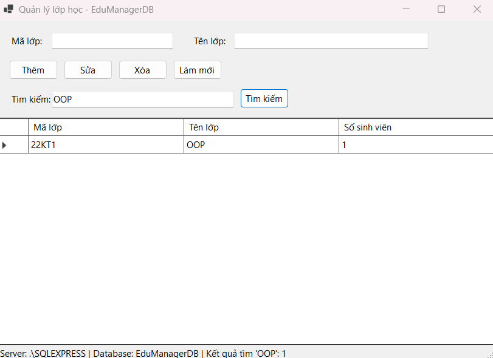

### Validation

**8. Cảnh báo khi thêm lớp có mã đã tồn tại**

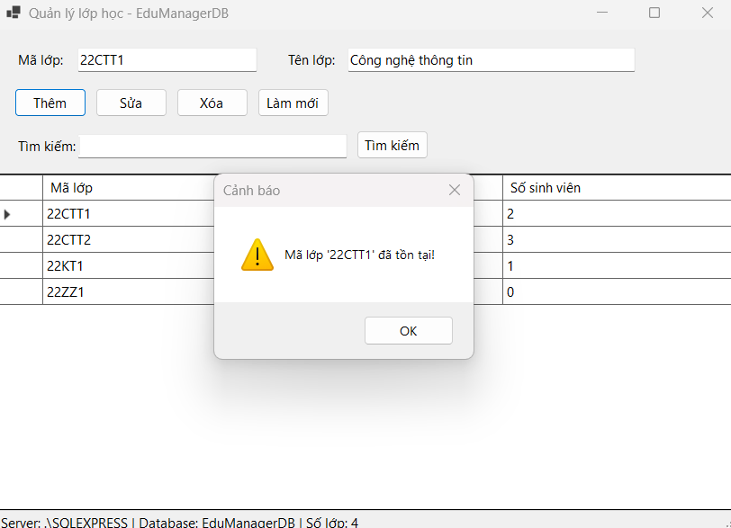

**9. Cảnh báo khi để trống mã lớp**

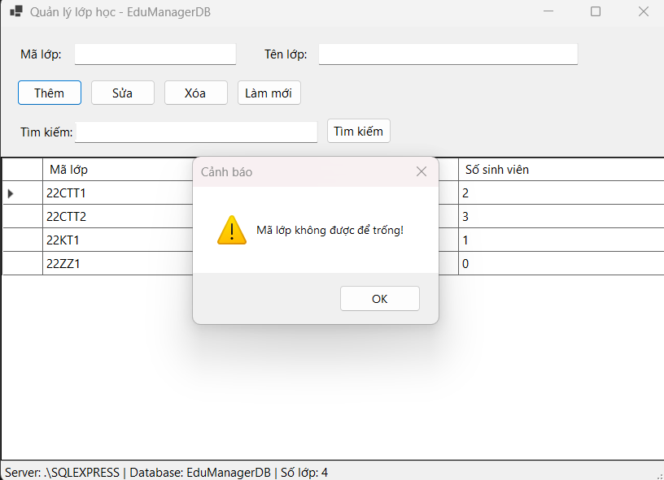

### Database trong SSMS

**10. Chạy script `EduManagerDB.sql` thành công; kết quả bảng `LOP` (7 lớp, 3 lớp mẫu có `MaKhoa` = NULL) và bảng `SINHVIEN` (6 sinh viên). Dấu X đỏ ở thanh dưới editor chỉ là gợi ý của IntelliSense, script vẫn chạy thành công (`Query executed successfully`)**

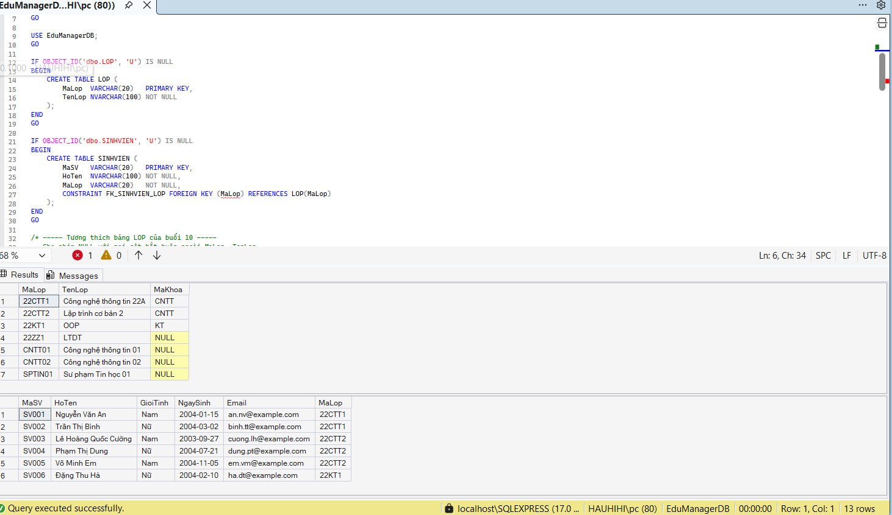

**11. Object Explorer: database `EduManagerDB` có các bảng `dbo.LOP`, `dbo.SINHVIEN`...**

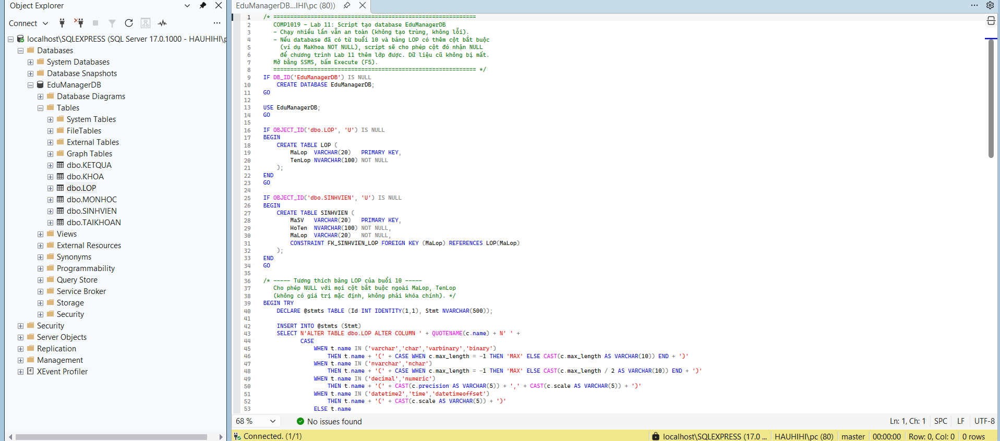
