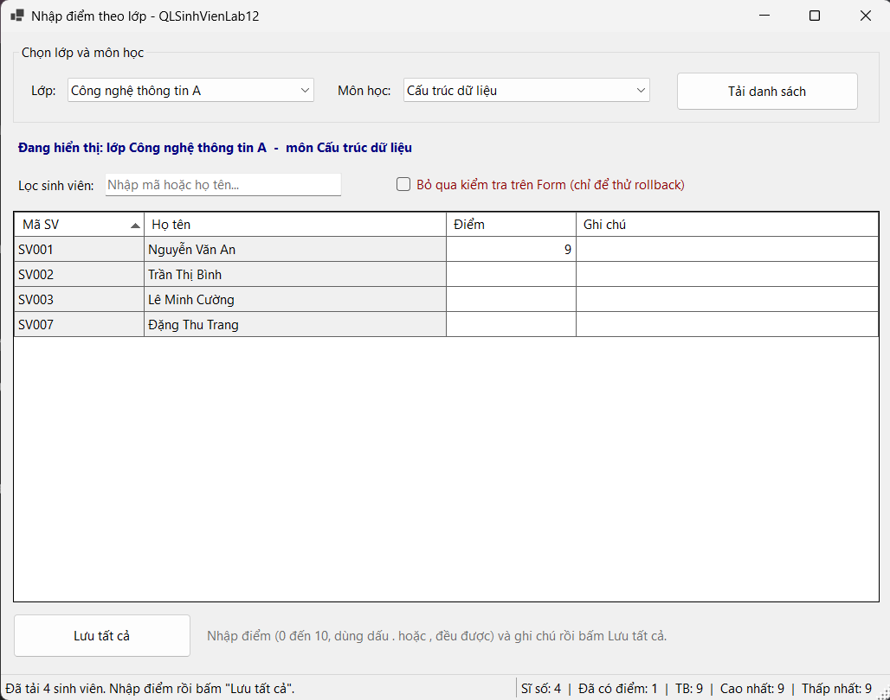
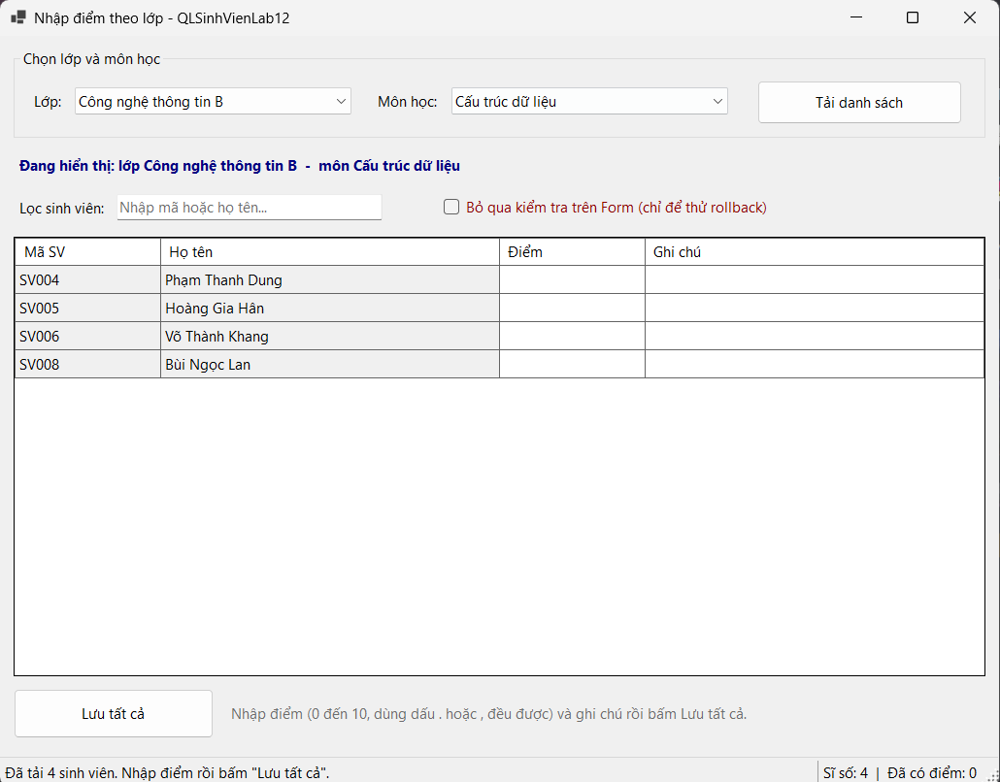
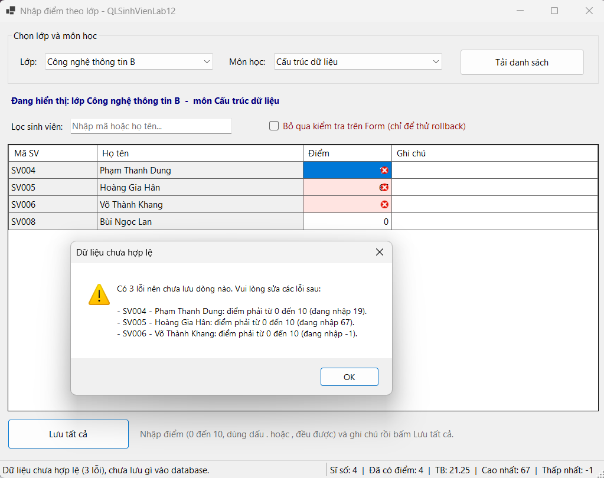
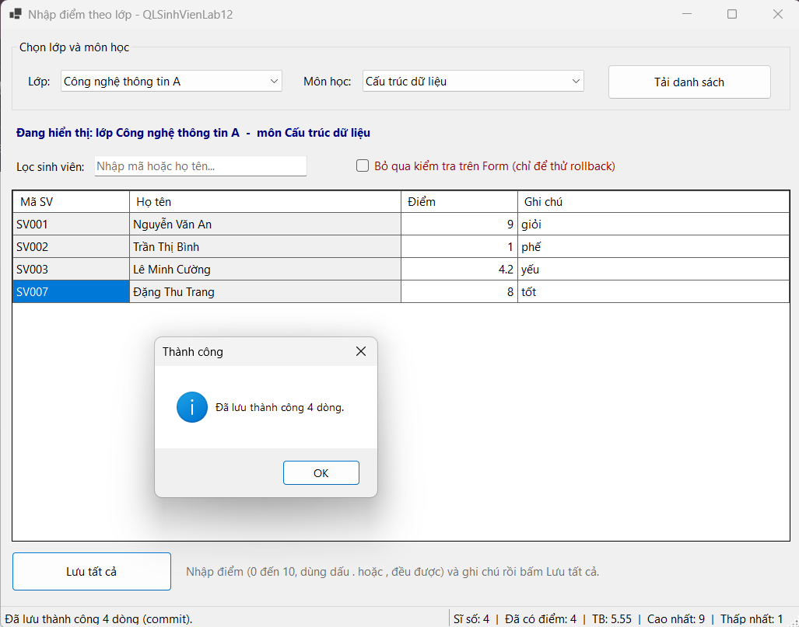
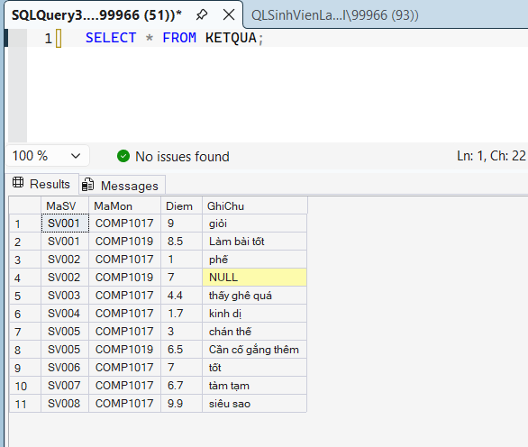

#  BÁO CÁO THỰC HÀNH LAB 12: DATA BINDING, STORED PROCEDURE & TRANSACTION

- **Học phần:** COMP1019 - Lập trình trên Windows
- **Giảng viên hướng dẫn:** ThS. Lê Thanh Thoại
- **Sinh viên thực hiện:** Lê Quốc Tuấn - 51.01.104.115
- **Môi trường phát triển:** Microsoft Visual Studio (C# WinForms, .NET) & Microsoft SQL Server (SSMS)
- **Thư viện kết nối:** `Microsoft.Data.SqlClient`
- **Cơ sở dữ liệu:** `QLSinhVienLab12`

---

## 1. Cấu trúc Dự án (Project Organization)

Dự án tuân thủ mô hình phân tầng rõ ràng, tách biệt giữa giao diện người dùng và tầng truy xuất dữ liệu (Clean Code):

```text
QLSinhVienLab12/
│
├── QLSinhVienLab12.sln                 # Solution dự án Visual Studio
├── README.md                          # Tài liệu báo cáo kỹ thuật
│
├── Database/
│   └── QLSinhVienLab12.sql              # Script DDL, DML, ràng buộc và 4 Stored Procedures
│
├── Images/                            # Thư mục chứa ảnh chụp minh chứng thực nghiệm
│   ├── list1.png                      # Giao diện tải danh sách lớp A
│   ├── list2.png                      # Giao diện tải danh sách lớp B
│   ├── before.png                     # Bẫy lỗi Validation & Rollback transaction
│   ├── after.png                      # Lưu thành công hàng loạt (Commit)
│   └── checkdatabase.png              # Đối soát dữ liệu trực tiếp trong SSMS
│
└── QLSinhVienLab12/
    ├── Program.cs                     # Điểm khởi chạy ứng dụng
    ├── DAL/                           # Tầng truy xuất dữ liệu (Data Access Layer)
    │   ├── Database.cs                # Quản lý cấu hình ConnectionString trung tâm
    │   └── KetQuaDAL.cs               # Xử lý Stored Procedure, DataTable & SqlTransaction
    └── Forms/                         # Tầng giao diện người dùng (Presentation Layer)
        ├── FrmNhapDiemTheoLop.cs        # Xử lý sự kiện UI, DataBinding, điều phối Transaction
        └── FrmNhapDiemTheoLop.Designer.cs

```

---

## 2. Thiết kế CSDL & Stored Procedures

### 2.1. Cấu trúc Bảng & Ràng buộc toàn vẹn

* **`LOP`** (`MaLop` [PK], `TenLop`)


* **`SINHVIEN`** (`MaSV` [PK], `HoTen`, `NgaySinh`, `MaLop` [FK])


* **`MONHOC`** (`MaMon` [PK], `TenMon`, `SoTinChi` [CHECK > 0])


* **`KETQUA`** (`MaSV` [PK, FK], `MaMon` [PK, FK], `Diem` [CHECK $0 \le \text{Diem} \le 10$], `GhiChu`)


### 2.2. Danh sách 4 Stored Procedures bắt buộc

1. **`sp_Lop_GetAll`**: Lấy danh sách lớp đổ vào `cboLop`.


2. **`sp_MonHoc_GetAll`**: Lấy danh mục môn học đổ vào `cboMonHoc`.


3. **`sp_KetQua_GetByLopMon`**: Lấy danh sách sinh viên theo lớp và môn học kèm điểm (dùng `LEFT JOIN` để hiển thị sinh viên chưa có điểm thành ô trống).


4. **`sp_KetQua_Save`**: Thực hiện Upsert (đã có điểm thì `UPDATE`, chưa có thì `INSERT`).


---

## 3. Minh chứng Thực nghiệm và Kiểm thử Giao diện

### 3.1. Tải danh sách sinh viên theo lớp và môn học qua Data Binding

* **Lớp Công nghệ thông tin A:**



* **Lớp Công nghệ thông tin B:**



### 3.2. Cơ chế Validation và Rollback Transaction khi phát hiện lỗi

Khi người dùng nhập điểm không hợp lệ (ví dụ: vượt quá khoảng $0 - 10$ như giá trị `19`, `67`, hoặc âm `-1`), hệ thống kiểm soát chặt chẽ trên Form, tô đỏ ô lỗi, liệt kê chi tiết trong hộp thoại cảnh báo và kích hoạt **Rollback** toàn bộ giao dịch, tuyệt đối không ghi nhận dữ liệu rác xuống CSDL:



### 3.3. Lưu hàng loạt dữ liệu thành công (Commit Transaction)

Trước khi nhập:


Sau khi chỉnh sửa điểm và ghi chú hợp lệ, nhấn nút **"Lưu tất cả"**, hệ thống mở transaction cập nhật thành công toàn bộ số dòng và hiển thị thông báo xác nhận:



### 3.4. Đối soát tính toàn vẹn dữ liệu trực tiếp trong SQL Server (SSMS)

Thực thi truy vấn `SELECT * FROM KETQUA;` trên SSMS để kiểm tra, dữ liệu điểm số và ghi chú đã được lưu trữ bền vững, khớp hoàn toàn với kết quả thao tác trên ứng dụng WinForms:



---

## 4. Hướng dẫn Cài đặt & Chạy Chương trình

1. **Khởi tạo Cơ sở dữ liệu:**
* Mở **SQL Server Management Studio (SSMS)**, chạy tệp script `Database/QLSinhVienLab12.sql` bằng phím `F5` để tạo CSDL, bảng, dữ liệu mẫu và các Stored Procedures.
2. **Cấu hình Kết nối:**
* Mở solution `QLSinhVienLab12.sln` trong Visual Studio.
* Kiểm tra chuỗi kết nối (`ConnectionString`) tại tệp `DAL/Database.cs` cho khớp với instance SQL Server cục bộ.
3. **Biên dịch & Thực thi:**
* Nhấn `Ctrl + Shift + B` để build dự án.
* Nhấn `F5` để chạy ứng dụng.

