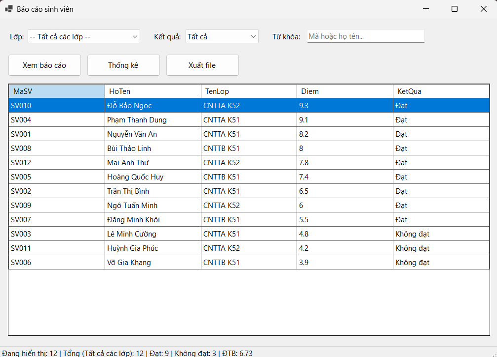
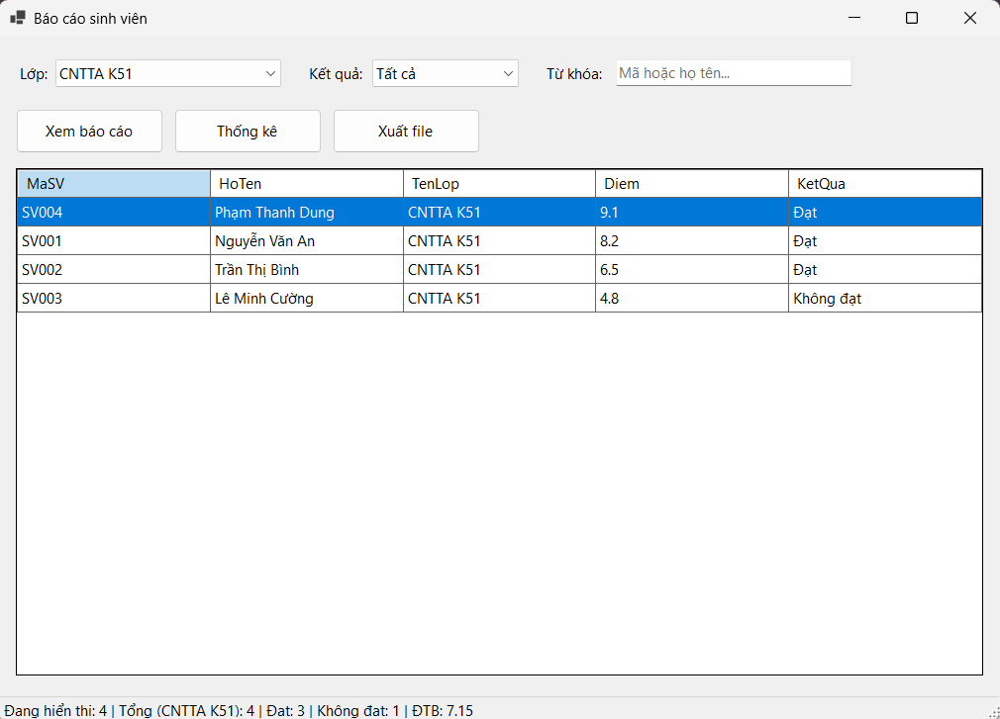
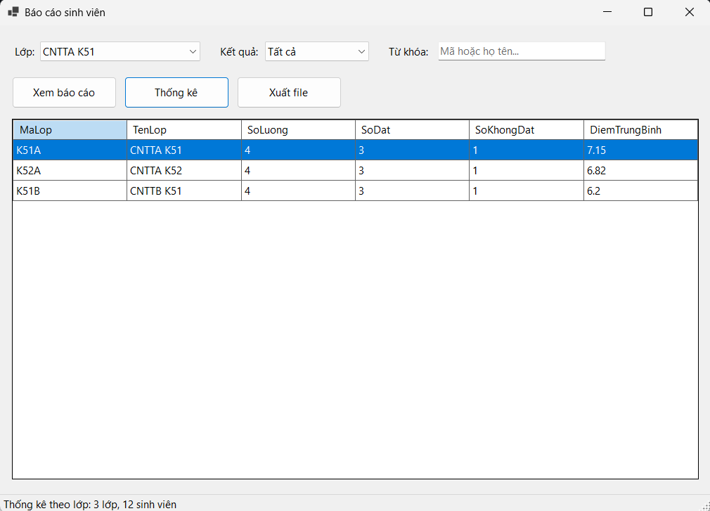
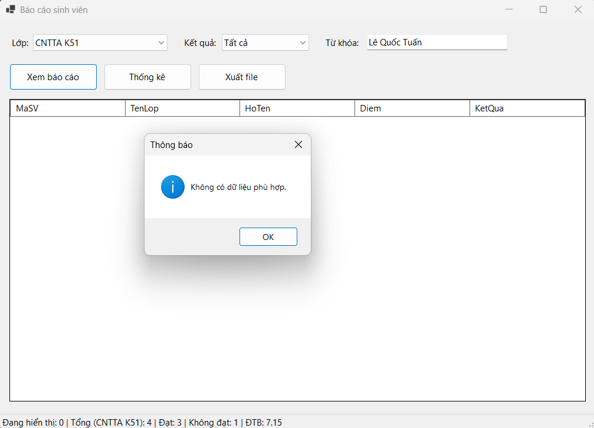
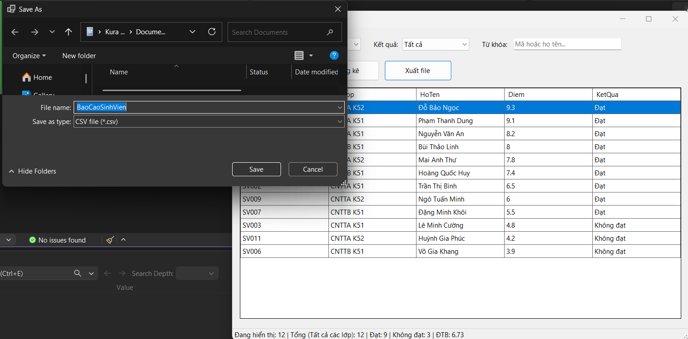

# BÁO CÁO THỰC HÀNH LAB 13: BÁO CÁO SINH VIÊN BẰNG LINQ

* **Học phần:** COMP1019 - Lập trình trên Windows
* **Giảng viên hướng dẫn:** ThS. Lê Thanh Thoại
* **Sinh viên thực hiện:** Lê Quốc Tuấn - 51.01.104.115
* **Môi trường phát triển:** Microsoft Visual Studio (C# WinForms - .NET 8.0)
* **Công nghệ cốt lõi:** LINQ to Objects, DataGridView, SaveFileDialog, File I/O (Stream/UTF-8 Encoding)
* **Tên Solution:** `StudentReportDemo.sln`

---

## 1. Cấu trúc Thư mục và Phân bổ Tệp tin

Dự án được phân tầng theo cấu trúc hướng đối tượng chuẩn:

```text
StudentReportDemo/
│
├── StudentReportDemo.sln                 # File Solution quản lý dự án
├── README.md                             # Tài liệu báo cáo kỹ thuật hoàn chỉnh
│
├── Images/                               # Thư mục chứa 5 ảnh chụp màn hình kiểm thử
│   ├── list.png                          # Giao diện khởi tạo toàn bộ danh sách sinh viên
│   ├── sortDL.png                        # Lọc và sắp xếp dữ liệu theo lớp
│   ├── thongke.png                       # Thống kê tổng hợp số liệu theo lớp
│   ├── failedsearch.png                  # Xử lý trường hợp không tìm thấy dữ liệu
│   └── outputlist.png                    # Hộp thoại xuất file báo cáo
│
└── StudentReportDemo/
    ├── StudentReportDemo.csproj          # Cấu hình dự án C# WinForms .NET 8.0
    ├── Program.cs                        # Điểm khởi chạy ứng dụng (Main)
    │
    ├── Models/
    │   └── SinhVien.cs                   # Lớp đối tượng thực thể SinhVien
    │
    └── Forms/
        ├── FrmBaoCaoSinhVien.cs          # Code-behind xử lý logic LINQ và sự kiện UI
        └── FrmBaoCaoSinhVien.Designer.cs # Định nghĩa và thiết kế trực quan giao diện

```

---

## 2. Thiết kế Lớp Thực thể (Model) và Bộ Dữ liệu Mẫu

### 2.1. Cấu trúc lớp `SinhVien` (`Models/SinhVien.cs`)

Lớp thực thể mô tả thông tin hồ sơ sinh viên với tính đóng gói và thuộc tính tính toán chỉ đọc:

| Tên thuộc tính | Kiểu dữ liệu | Đặc tả chức năng |
| --- | --- | --- |
| `MaSV` | `string` | Mã định danh sinh viên (Ví dụ: `SV001`, `SV002`,...) |
| `HoTen` | `string` | Họ và tên đầy đủ của sinh viên |
| `MaLop` | `string` | Mã lớp sinh hoạt (`K51A`, `K51B`, `K52A`) |
| `TenLop` | `string` | Tên diễn giải đầy đủ của lớp học (`CNTTA K51`, `CNTTB K51`, `CNTTA K52`) |
| `Diem` | `double` | Điểm trung bình tích lũy học tập |
| `KetQua` | `string` *(read-only)* | Biểu thức điều kiện: Trả về `"Đạt"` nếu $\text{Diem} \ge 5.0$, ngược lại `"Không đạt"` |

### 2.2. Bộ dữ liệu mẫu (`TaoDuLieuMau`)

* **Quy mô danh sách:** Khởi tạo danh sách gồm **12 sinh viên**, phân bổ đều vào **3 lớp** (`K51A`, `K51B`, `K52A`).
* **Phân bố kết quả:** Điểm số trải rộng từ $3.9$ đến $9.3$, bảo đảm đầy đủ các trường hợp kiểm thử cho cả kết quả "Đạt" và "Không đạt".

---

## 3. Đặc tả Danh mục Thành phần Điều khiển (Controls)

| Nhóm chức năng | Tên Control | Kiểu Control | Chức năng chi tiết |
| --- | --- | --- | --- |
| **Tiêu đề** | `lblLop` / `lblKetQua` / `lblTuKhoa` | `Label` | Nhãn chú thích các tiêu chí lọc |
| **Bộ lọc** | `cboLop` | `ComboBox` | Danh sách chọn lớp: gồm `-- Tất cả các lớp --` và các lớp chuyên ngành |
|  | `cboKetQua` | `ComboBox` | Điều kiện kết quả học tập: `"Tất cả"`, `"Đạt"`, `"Không đạt"` |
|  | `txtTuKhoa` | `TextBox` | Nhập từ khóa tra cứu gần đúng theo mã hoặc họ tên |
| **Thao tác** | `btnXemBaoCao` | `Button` | Thực thi LINQ lọc và sắp xếp giảm dần theo điểm |
|  | `btnThongKe` | `Button` | Thực thi LINQ gom nhóm thống kê số lượng và điểm TB lớp |
|  | `btnXuatFile` | `Button` | Kích hoạt `SaveFileDialog` xuất dữ liệu ra file CSV/TXT |
| **Bảng hiển thị** | `dgvBaoCao` | `DataGridView` | Hiển thị danh sách chi tiết hoặc kết quả thống kê |
| **Trạng thái** | `statusStrip1` / `lblThongKe` | `StatusStrip` | Thanh trạng thái đáy form hiển thị thông số chi tiết (Sĩ số, Đạt, Không đạt, ĐTB) |

---

## 4. Tổ chức Mã nguồn và Kỹ thuật Xử lý LINQ

### 4.1. Nạp danh mục lựa chọn tích hợp tùy chọn "Tất cả" (`LoadComboBox`)

Sử dụng `GroupBy` kết hợp `OrderBy` trên `TenLop` và chèn phần tử `ALL` lên đầu danh sách:

```csharp
var dsLop = danhSachSinhVien
    .GroupBy(sv => sv.MaLop)
    .Select(g => new { MaLop = g.Key, TenLop = g.First().TenLop })
    .OrderBy(lop => lop.TenLop)
    .ToList();

dsLop.Insert(0, new { MaLop = "ALL", TenLop = "-- Tất cả các lớp --" });
cboLop.DataSource = dsLop;
cboLop.DisplayMember = "TenLop";
cboLop.ValueMember = "MaLop";

```

### 4.2. Lọc dữ liệu kết hợp đa điều kiện & Sắp xếp giảm dần (`XemBaoCao`)

Áp dụng cơ chế truy vấn trì hoãn và sắp xếp theo điểm số từ cao đến thấp (`OrderByDescending`):

```csharp
string maLop = cboLop.SelectedValue?.ToString() ?? "ALL";
string ketQua = cboKetQua.SelectedItem?.ToString() ?? "Tất cả";
string tuKhoa = txtTuKhoa.Text.Trim().ToLower();

var query = (maLop == "ALL") 
    ? danhSachSinhVien.AsEnumerable() 
    : danhSachSinhVien.Where(sv => sv.MaLop == maLop);

if (ketQua == "Đạt")
    query = query.Where(sv => sv.Diem >= 5);
else if (ketQua == "Không đạt")
    query = query.Where(sv => sv.Diem < 5);

if (!string.IsNullOrWhiteSpace(tuKhoa))
    query = query.Where(sv => sv.MaSV.ToLower().Contains(tuKhoa) || sv.HoTen.ToLower().Contains(tuKhoa));

var baoCao = query
    .OrderByDescending(sv => sv.Diem)
    .ThenBy(sv => sv.HoTen)
    .Select(sv => new { sv.MaSV, sv.HoTen, sv.TenLop, sv.Diem, sv.KetQua })
    .ToList();   

```

### 4.3. Gom nhóm và Thống kê theo từng Lớp (`btnThongKe_Click`)

Sử dụng toán tử `GroupBy` theo cặp khóa `MaLop` và `TenLop`:

```csharp
var thongKe = danhSachSinhVien
    .GroupBy(sv => new { sv.MaLop, sv.TenLop })
    .Select(g => new
    {
        g.Key.MaLop,
        g.Key.TenLop,
        SoLuong = g.Count(),
        SoDat = g.Count(sv => sv.Diem >= 5),
        SoKhongDat = g.Count(sv => sv.Diem < 5),
        DiemTrungBinh = Math.Round(g.Average(sv => sv.Diem), 2)
    })
    .OrderBy(x => x.TenLop)
    .ToList();

```

---

## 5. Minh chứng Thực nghiệm và Bảng Kiểm thử

Bảng đối soát 5 ca kiểm thử chức năng tương ứng với bộ ảnh thực tế trong thư mục `images`:

| STT | Kịch bản kiểm thử | Thao tác thực hiện | Kết quả mong đợi | Trạng thái |
| --- | --- | --- | --- | --- |
| **TC01** | Khởi tạo giao diện ban đầu | Mở ứng dụng | Tải đủ 12 SV từ các lớp, sắp xếp điểm giảm dần, hiển thị đầy đủ thông số thống kê ở thanh trạng thái.

 | **PASS** |
| **TC02** | Lọc dữ liệu theo lớp cụ thể | Chọn lớp `CNTTA K51` $\rightarrow$ Bấm Xem báo cáo | Bảng lọc chính xác 4 sinh viên thuộc lớp `CNTTA K51`, sắp xếp giảm dần theo điểm.

 | **PASS** |
| **TC03** | Thống kê dữ liệu theo lớp | Bấm nút Thống kê | Lưới chuyển sang bảng tổng hợp: Mã lớp, Tên lớp, Số lượng, Số đạt, Số không đạt, Điểm trung bình.

 | **PASS** |
| **TC04** | Xử lý khi không có dữ liệu | Nhập từ khóa không tồn tại (VD: "Lê Quốc Tuấn") $\rightarrow$ Xem báo cáo | Hiển thị hộp thoại cảnh báo *"Không có dữ liệu phù hợp"* trực quan cho người dùng.

 | **PASS** |
| **TC05** | Xuất báo cáo ra file văn bản | Bấm Xuất file $\rightarrow$ Chọn vị trí lưu tệp CSV/TXT | Mở hộp thoại `SaveFileDialog` để lưu tệp báo cáo chuẩn xác.

 | **PASS** |

### 5.1. Khởi tạo form và hiển thị toàn bộ danh sách (`list.png`)



### 5.2. Lọc và sắp xếp dữ liệu theo lớp (`sortDL.png`)



### 5.3. Thống kê số lượng và điểm trung bình theo lớp (`thongke.png`)



### 5.4. Thông báo thân thiện khi không tìm thấy dữ liệu (`failedsearch.png`)



### 5.5. Hộp thoại lưu file báo cáo (`outputlist.png`)



---

## 6. Hướng dẫn Biên dịch và Sử dụng

1. **Môi trường yêu cầu:** Cài đặt **Visual Studio 2022** (.NET 8.0 SDK / Windows Forms Desktop).
2. **Biên dịch dự án:** Mở file `StudentReportDemo.sln`, nhấn tổ hợp phím `Ctrl + Shift + B` để build toàn bộ mã nguồn.
3. **Thực thi chương trình:** Nhấn `F5` để chạy ứng dụng:
* Chọn tiêu chí lọc lớp học hoặc kết quả để xem danh sách chi tiết[cite: 23, 25].
* Bấm **Thống kê** để xem bảng tổng hợp theo từng lớp.


* Bấm **Xuất file** để lưu kết quả báo cáo ra đĩa cứng dưới định dạng `.csv` hoặc `.txt`.
